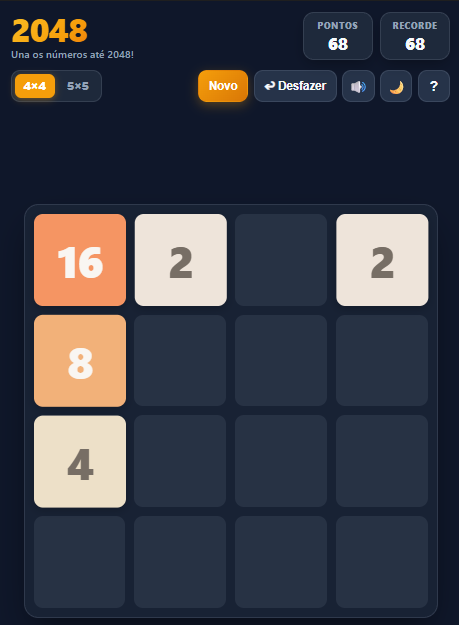

# 🔢 2048 — Jogo de Lógica e Deslize

[](https://denis-tek.github.io/jogos/2048/)
[](https://denis-tek.github.io/jogos/)
[](#tecnologias-utilizadas)
[](#tecnologias-utilizadas)
[](#tecnologias-utilizadas)

Recriação moderna, responsiva e tátil do clássico quebra-cabeça numérico **2048**, desenvolvida em **HTML5, CSS3 e JavaScript puro** em um único arquivo autônomo (`index.html`), sem dependências externas de imagens ou arquivos de áudio.

🔗 **Jogar online:** [https://denis-tek.github.io/jogos/2048/](https://denis-tek.github.io/jogos/2048/)

---

## 🖼️ Preview



---

## ✨ Principais Recursos

* **📐 Dois Modos de Tabuleiro (`4×4` e `5×5`):** Alterne entre a grade clássica **4×4** e a grade expandida **5×5**, cada uma com salvamento automático de partida em andamento e recorde independente.
* **🎨 Duplo Tema Visual (Escuro & Claro):** Alternância instantânea entre o tema **Dark Moderno** (padrão) e o tema **Claro Clássico Aconchegante** inspirado no original de 2014, com paleta cromática progressiva e brilho dinâmico nas peças de alto valor (`128` até `4096+`).
* **↩ Sistema de Desfazer (*Undo*):** Histórico integrado de até **10 jogadas anteriores**, permitindo corrigir movimentos acidentais a qualquer momento (inclusive na tela de *Fim de Jogo*).
* **♾️ Modo Infinito Pós-2048:** Ao formar o bloco **2048**, o jogador pode celebrar a vitória e escolher continuar na mesma partida para buscar potências maiores (`4096`, `8192` e além).
* **🔊 Áudio Procedural (Web Audio API):** Síntese sonora em tempo real sem arquivos externos — deslizes suaves, notas em escala pentatônica maior que sobem conforme o valor da fusão, harmônicos extras em blocos altos (`>= 128`) e fanfarras de vitória.
* **📱 Layout *Zero-Scroll* (`100dvh`) & Alinhamento Milimétrico:** Interface totalmente adaptada para telas móveis e desktop sem barra de rolagem, com sincronização contínua via `ResizeObserver` e animações fluidas aceleradas por hardware (`translate3d`).

---

## 🎮 Controles & Como Jogar

| Plataforma | Ação / Comando | Descrição |
| :--- | :--- | :--- |
| **Desktop (Teclado)** | `Setas` ou `W A S D` | Desliza todos os blocos do tabuleiro na direção escolhida. |
| **Desktop (Atalhos)** | `Z` / `R` / `Esc` | Desfaz a última jogada (`Z`), inicia novo jogo (`R`) ou fecha janelas (`Esc`). |
| **Mobile / Touch** | **Deslizar (*Swipe*)** | Arraste o dedo sobre o tabuleiro para cima, baixo, esquerda ou direita. |

### Regras Básicas
1. A cada movimento válido, todos os blocos deslizam até o limite da grade e um novo bloco (`2` com 90% de chance ou `4` com 10% de chance) surge em uma casa vazia.
2. Quando dois blocos com o **mesmo número** colidem durante o deslize, eles se fundem em um único bloco com a soma de seus valores (`2 + 2 = 4`, `4 + 4 = 8`...), somando essa pontuação ao placar.
3. O objetivo principal é alcançar o bloco **2048** antes que o tabuleiro fique completamente cheio sem fusões adjacentes disponíveis.

---

## 📁 Estrutura do Projeto

```text
2048/
├── index.html   # Aplicação completa do jogo (HTML5 + CSS3 + JS + Web Audio API)
├── thumb.svg    # Miniatura vetorial exibida no launcher principal
├── imagem.png   # Captura de tela do jogo em execução
└── README.md    # Documentação técnica e instruções do projeto
```

---

## 🛠️ Tecnologias Utilizadas

* **HTML5 Semântico & ARIA:** Estrutura acessível com diálogos modais (`role="dialog"`) e navegação por teclado.
* **CSS3 Moderno:** Uso de `Custom Properties` para temas, `CSS Grid`, `Flexbox`, `100dvh`, animações `@keyframes` e transições `translate3d` em 60 FPS.
* **JavaScript Nativo (ES2020+):** Motor de movimentação e fusão matricial, fila de estados para *Undo*, `Pointer Events` unificados para gestos de *swipe* e `ResizeObserver`.
* **Web Audio API & `localStorage`:** Geração procedural de efeitos sonoros musicais e persistência local de recordes, partidas em andamento e preferências de tema/som.

---

## 🚀 Como Executar Localmente

Por seguir a arquitetura **Single-File Self-Contained**, não há etapa de compilação ou instalação de dependências:

1. Clone este repositório:
   ```bash
   git clone https://github.com/Denis-Tek/jogos.git
   ```
2. Abra o arquivo `2048/index.html` diretamente no seu navegador preferido (ou inicie um servidor HTTP simples na raiz do repositório, como `python -m http.server 8000`, e acesse `http://localhost:8000/2048/`).

---

Desenvolvido por **[Denis-Tek](https://github.com/Denis-Tek)**.