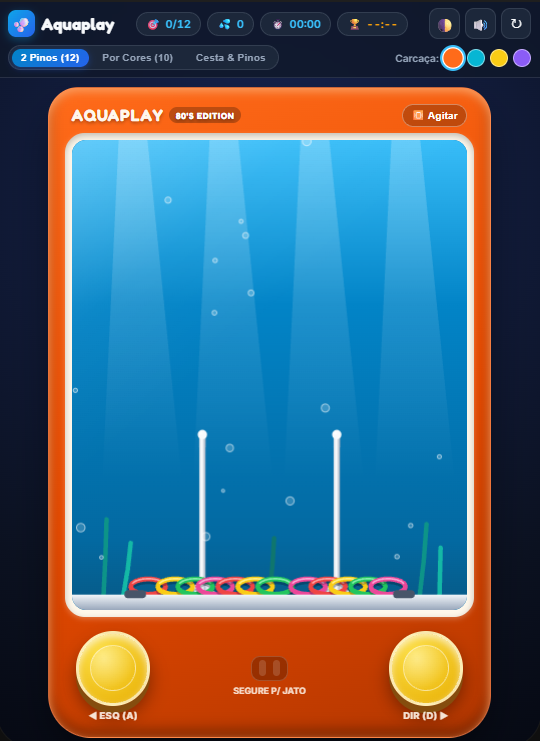

# 🫧 Aquaplay Clássico — Edição Anos 80

[](https://denis-tek.github.io/jogos/aquaplay/)
[](https://denis-tek.github.io/jogos/)
[](#tecnologias-utilizadas)
[](#tecnologias-utilizadas)
[](#tecnologias-utilizadas)

Recriação fiel e nostálgica do clássico brinquedo aquático portátil dos anos 80 (popularizado no Brasil pela **Estrela**), desenvolvida em **HTML5, CSS3 e JavaScript puro** em um único arquivo autônomo (`index.html`), sem dependências externas.

🔗 **Jogar online:** [https://denis-tek.github.io/jogos/aquaplay/](https://denis-tek.github.io/jogos/aquaplay/)

---

## 🖼️ Preview



---

## ✨ Principais Recursos

### 🕹️ Carcaça Retrô Interativa & Personalizável
- **Design Tátil Nostálgico:** Reproduz o formato icônico do brinquedo portátil com moldura acrílica, reflexos de luz na água, bocais injetores inferiores, medidor em tempo real da pressão hidrodinâmica dos êmbolos e botão **📳 Agitar**.
- **4 Cores de Carcaça:** Alterne instantaneamente entre **Laranja Clássico Estrela**, **Azul Turquesa**, **Amarelo Solar** e **Roxo Translúcido Neon**, além de suporte a **Tema Escuro** e **Tema Claro** na página.
- **Layout Zero-Scroll (`100dvh`):** Responsivo e calibrado para telas de celular (modo retrato) e desktop sem barras de rolagem.

### 🎯 3 Modos de Jogo
1. **2 Pinos (12 Argolas):** Modo clássico onde o objetivo é encaixar todas as 12 argolas coloridas nos dois pinos centrais no menor tempo possível.
2. **Por Cores (10 Argolas):** Desafio de separação cromática — encaixe as argolas **Vermelhas e Rosas** no pino esquerdo e as **Verdes e Amarelas** no pino direito.
3. **Cesta & Pinos:** Além dos dois pinos laterais, conta com uma cesta elevada central que concede pontuação bônus (`+250 pts`).

### 🌊 Física de Fluidos 2D & Áudio Procedural
- **Simulação Subaquática:** Modelagem de gravidade reduzida pelo empuxo da água, arrasto viscoso, torque restaurador angular, convecção suave, empilhamento 3D nos pinos e risco real de expulsar argolas já encaixadas caso um jato forte atinja por baixo.
- **Web Audio API:** Síntese sonora em tempo real para o estalo mecânico dos botões plásticos, rajadas de bolhas subaquáticas, tilintar ao encaixar argolas, agitação do tanque e fanfarra de vitória.
- **Persistência Local (`localStorage`):** Salva automaticamente o melhor tempo de cada modo (`aquaplay_records`), além da cor da carcaça, tema e preferência de som (`aquaplay_prefs`).

---

## 🎮 Controles & Como Jogar

| Ação | Mouse / Touch | Teclado |
| :--- | :--- | :--- |
| **Jato Esquerdo** | Clique ou segure o botão esquerdo (`◀ Esq`) | `A` ou `Seta Esquerda (◀)` |
| **Jato Direito** | Clique ou segure o botão direito (`Dir ▶`) | `D` ou `Seta Direita (▶)` |
| **Agitar Aparelho** | Toque em **📳 Agitar** no topo do brinquedo | `Barra de Espaço` |

> 💡 **Dica:** Toques curtos e alternados oferecem maior precisão para alinhar as argolas na descida; segurar o botão mantém um fluxo contínuo com decaimento gradual de pressão, exatamente como nos êmbolos de ar originais.

---

## 📁 Estrutura do Projeto

```text
aquaplay/
├── index.html   # Aplicação completa autocontida (HTML5 + CSS3 + JS + Canvas 2D + Web Audio)
├── thumb.svg    # Miniatura vetorial exibida no launcher principal
├── imagem.png   # Captura de tela do jogo em execução
└── README.md    # Documentação técnica e regras do projeto
```

---

## 🛠️ Tecnologias Utilizadas

- **HTML5 Semântico & Canvas 2D High-DPI:** Renderização fluida a 60 FPS com escala adaptativa via `ResizeObserver` e camadas de profundidade para o encaixe realista das argolas nos pinos.
- **CSS3 Moderno:** Custom Properties dinâmicas para troca instantânea de carcaças e temas, Flexbox e layout responsivo sem rolagem (`100dvh`).
- **JavaScript (ES2020+):** Motor de física 2D subaquática, gerenciamento de partículas de bolhas, detecção de colisões entre argolas/pinos/cesta e eventos unificados (`Pointer Events`).
- **Web Audio API & Web Storage API:** Efeitos sonoros 100% procedurais e armazenamento persistente de recordes e preferências no navegador.

---

## 🚀 Como Executar Localmente

1. Clone este repositório:
   ```bash
   git clone https://github.com/Denis-Tek/jogos.git
   ```
2. Acesse a pasta `aquaplay/` e abra o arquivo `index.html` diretamente em qualquer navegador moderno (ou inicie um servidor local na raiz `jogos/` com `python -m http.server 8000`).

---

Desenvolvido por **[Denis-Tek](https://github.com/Denis-Tek)**.