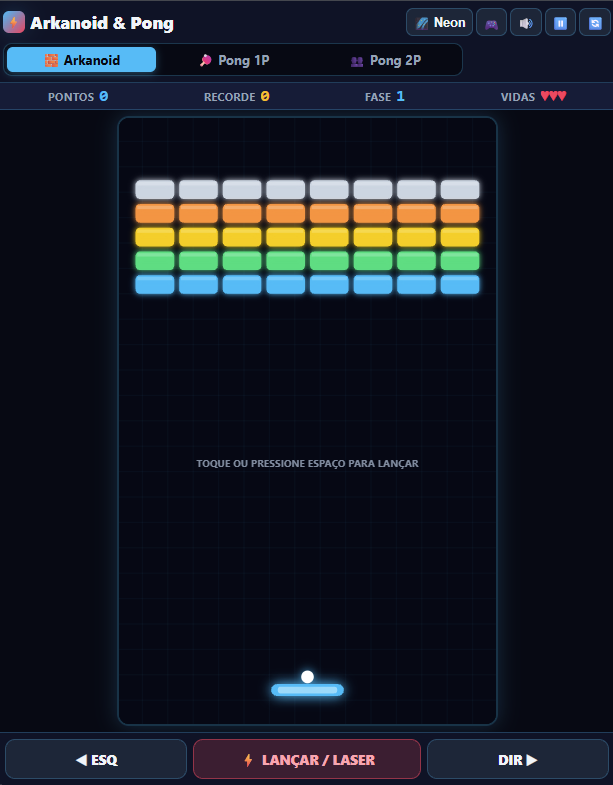

# ⚡ Arkanoid & Pong

[](https://denis-tek.github.io/jogos/arkanoid-pong/)
[](https://denis-tek.github.io/jogos/)

Dois pilares históricos dos arcades reunidos em uma única aplicação web responsiva e autocontida (`index.html`), desenvolvida em **HTML5 Canvas, CSS3 e JavaScript puro**, com motor de física contínua em 60 FPS, duplo tema visual e sintetizador sonoro em tempo real via **Web Audio API**.

🔗 **Link para execução online:** [https://denis-tek.github.io/jogos/arkanoid-pong/](https://denis-tek.github.io/jogos/arkanoid-pong/)

---

## 🖼️ Preview



---

## ✨ Principais Recursos

- **3 Modos de Jogo Integrados (Seletor Rápido no Topo):**
  - **🧱 Arkanoid Pro:**
    - **5 Fases Cíclicas:** *Muralha Clássica*, *Pirâmide Solar*, *Fortaleza Blindada*, *Túnel Quântico* e *Diamante Supremo*, com dificuldade progressiva nos ciclos seguintes.
    - **Blocos Variados:** Blocos comuns coloridos, blindados prateados (`2` golpes com rachadura visual), dourados (`3` golpes) e obstáculos metálicos indestrutíveis.
    - **5 Cápsulas de Power-Up:** `E` **Expandir Barra** (aumenta temporariamente a largura da plataforma), `M` **Multiball 3x** (multiplica as esferas ativas), `L` **Canhão Laser** (disparadores duplos na barra), `F` **Bola de Fogo** (atravessa blocos destrutíveis sem ricochetear) e `+` **Vida Extra** (esfera reserva adicional).
    - **Sistema de Combos:** Sequências rápidas de destruição multiplicam a pontuação em até **4×**.
  - **🏓 Pong 1P (vs IA):** Arena vertical unificada otimizada tanto para celulares em modo retrato quanto para desktop, em partidas de **7 pontos**, com Inteligência Artificial em 3 níveis (*Fácil*, *Médio* e *Difícil*) calibrados com previsão de trajetória e tempo de reação.
  - **👥 Pong 2P (Duelo Local):** Partida local para dois jogadores na mesma tela com suporte **multi-touch simultâneo** (Jogador 1 na metade inferior e Jogador 2 na metade superior) ou teclado duplo.
- **Física Contínua em Sub-Steps:** Cálculo de ângulo de reflexão baseado no ponto de impacto na barra e aplicação de **efeito lateral (*Spin*)** conforme a velocidade de deslocamento da raquete.
- **2 Temas Visuais Instantâneos:** Alternância entre **🌌 Neon Arcade** (fundo espacial escuro com brilho difuso e partículas luminosas) e **📺 Retrô Clássico** (paleta monocromática verde/âmbar com efeito de *scanlines* CRT).
- **Áudio Procedural & Persistência (`localStorage`):** Efeitos sintetizados em tempo real via **Web Audio API** (rebotes, escala musical ascendente nos combos, lasers, power-ups e fanfarras) e salvamento automático do recorde do Arkanoid, vitórias no Pong e preferências de tema/som.

---

## 🎮 Controles & Como Jogar

### Computador (Teclado e Mouse)
| Comando | Ação |
| :--- | :--- |
| **Mouse** | Move a barra horizontalmente com precisão direta |
| `←` / `→` ou `A` / `D` | Move a barra do Jogador 1 (Base) |
| `A` / `D` ou `W` / `S` | Move a barra do Jogador 2 (Topo) no modo **Pong 2P** |
| `Espaço` ou `Clique` | Lança a esfera inicial e dispara **Lasers** (no modo Arkanoid) |
| `P` ou `Esc` | Pausa / Retoma a partida |

### Dispositivos Móveis (Touch)
- **Arraste Direto na Arena:** Deslize o dedo em qualquer ponto da tela para controlar a barra (no modo **Pong 2P**, a metade inferior controla o **J1** e a metade superior controla o **J2**).
- **Controles Táteis Inferiores (`🎮`):** Barra opcional na base da tela com botões dedicados para esquerda, direita e lançamento/disparo.

---

## 📁 Estrutura do Projeto

```text
arkanoid-pong/
├── index.html   # Aplicação completa autocontida (HTML5 + CSS3 + JS + Canvas + Web Audio)
├── thumb.svg    # Miniatura vetorial exibida no launcher principal
├── imagem.png   # Captura de tela do jogo em execução
└── README.md    # Documentação do projeto
```

---

## 🛠️ Tecnologias Utilizadas

- **HTML5 Canvas 2D:** Renderização acelerada em 60 FPS com suporte a telas High-DPI (`devicePixelRatio`), rastros de movimento e sistema de partículas.
- **CSS3 Moderno:** Variáveis dinâmicas (`Custom Properties`), Flexbox e layout responsivo *zero-scroll* (`100dvh`).
- **JavaScript (ES6+):** Loop de jogo com *delta time* e sub-passos de colisão, IA preditiva e gerenciamento de estado.
- **Web Audio API:** Síntese sonora procedural nativa sem dependências de arquivos `.mp3` ou `.wav`.

---

## 🚀 Como Executar Localmente

1. Clone este repositório:
   ```bash
   git clone https://github.com/Denis-Tek/jogos.git
   ```
2. Inicie um servidor HTTP simples na pasta raiz `jogos/` (ex.: `python -m http.server 8000`) e acesse `http://localhost:8000/arkanoid-pong/`, ou abra `arkanoid-pong/index.html` diretamente no navegador.

---

Desenvolvido por **[Denis-Tek](https://github.com/Denis-Tek)**.