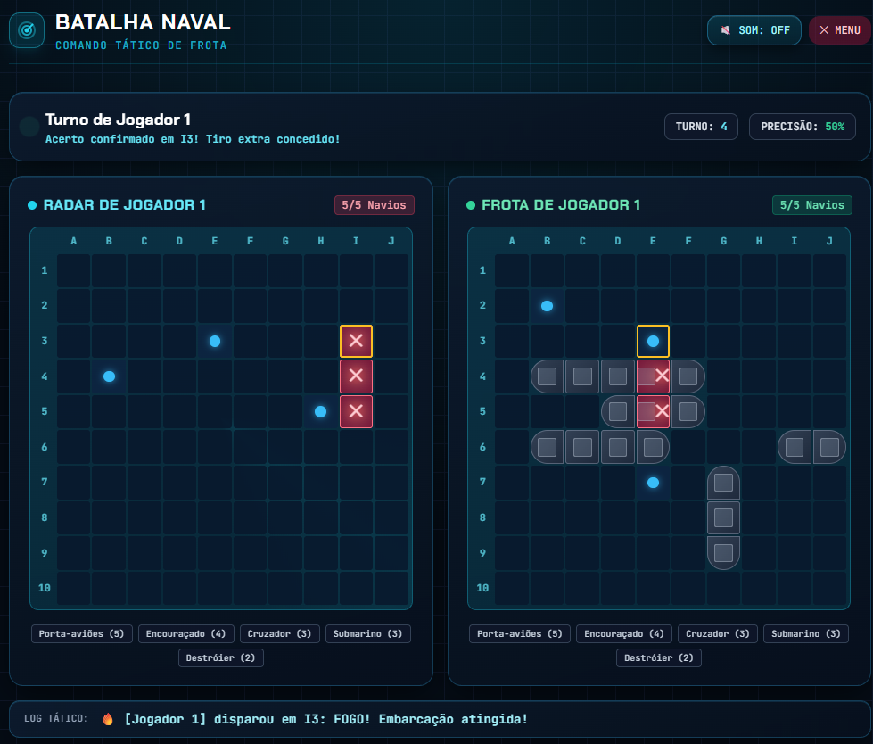

# 🚢 Batalha Naval — Comando Tático

[](https://denis-tek.github.io/jogos/batalha-naval/)
[](https://denis-tek.github.io/jogos/)

Versão web moderna e responsiva do clássico jogo de estratégia naval **Batalha Naval**, desenvolvida em **arquivo único autônomo (`index.html`)** com estética de radar tático, inteligência artificial baseada em densidade probabilística e efeitos sonoros sintetizados em tempo real.

🔗 **Link para execução online:** [https://denis-tek.github.io/jogos/batalha-naval/](https://denis-tek.github.io/jogos/batalha-naval/)

---

## 📸 Preview



---

## ✨ Funcionalidades e Regras do Jogo

* **Modos de Jogo & Privacidade:**
  * **1 Jogador vs IA:** Enfrente o Comandante IA em três níveis de dificuldade (**Fácil**, **Médio** e **Difícil**).
  * **2 Jogadores (Passar e Jogar):** Disputa local no mesmo dispositivo com **Cortina de Privacidade** automática entre turnos para ocultar o posicionamento da frota adversária.
* **Inteligência Artificial em 3 Níveis:**
  * **Fácil:** Disparos aleatórios pelo oceano `10×10`.
  * **Médio:** Algoritmo de **Caça e Perseguição (*Hunt & Target*)**, explorando células adjacentes após confirmar um acerto.
  * **Difícil:** Cálculo dinâmico de **mapa de densidade probabilística** combinado com paridade de grade e travamento direcional de embarcações alinhadas.
* **Fase de Posicionamento Interativa:**
  * Posicionamento manual na grade `10×10` (`A–J`, `1–10`) com pré-visualização de encaixe válido/inválido, rotação rápida via botão, tecla `R` ou clique direito, além de distribuição **Aleatória** com um clique.
* **Regras Customizáveis & HUD Tático:**
  * Opção para ativar ou desativar o **Tiro Extra ao Acertar**, exibição simultânea dos tabuleiros de **Radar (Ataque)** e **Frota (Defesa)** no desktop, abas otimizadas no mobile, contador de precisão e log tático de combate.

### Composição da Frota (`10×10`)

| Embarcação | Tamanho (Casas) |
| :--- | :---: |
| **Porta-aviões** | `5` |
| **Encouraçado** | `4` |
| **Cruzador** | `3` |
| **Submarino** | `3` |
| **Destróier** | `2` |

---

## 🛠️ Tecnologias e Algoritmos

* **HTML5 & Tailwind CSS (via CDN) + CSS3 Customizado:** Estrutura semântica, estética de sonar/radar naval e layout responsivo *mobile-first*.
* **JavaScript (ES6+) — Mapa de Densidade Probabilística:** Motor de estados completo para posicionamento, validação de colisões, *Hunt & Target* e cálculo de probabilidades por célula restante.
* **Web Audio API:** Síntese sonora procedural de ping de sonar, posicionamento de embarcações, impacto na água (*splash*), explosões e fanfarra de vitória sem arquivos externos.

---

## 🚀 Como Executar Localmente

1. Clone o repositório principal:
   ```bash
   git clone https://github.com/Denis-Tek/jogos.git
   ```
2. Abra o arquivo `batalha-naval/index.html` diretamente em qualquer navegador moderno.

---

Desenvolvido por **[Denis-Tek](https://github.com/Denis-Tek)**.