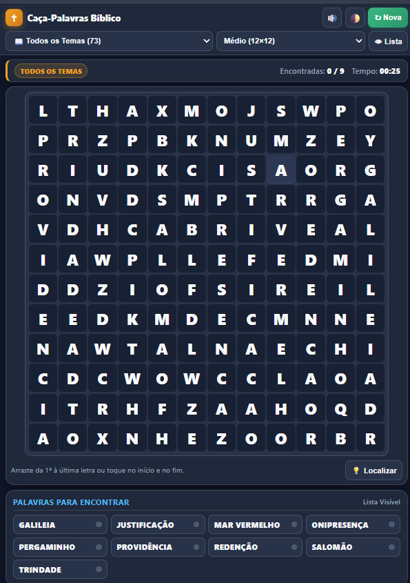

# 🔍 Caça-Palavras Bíblico

[](https://denis-tek.github.io/jogos/caca-palavras/)
[](https://denis-tek.github.io/jogos/)

Um passatempo educativo e interativo de **Caça-Palavras Bíblico** desenvolvido em **HTML5, CSS3 e JavaScript puro** em arquivo único (`index.html`), com **geração dinâmica de grades**, **Modo Estudo** baseado em dicas bíblicas, traçado vetorial colorido em SVG e layout responsivo otimizado para acessibilidade em telas móveis e desktop.

🔗 **Link para execução online:** [https://denis-tek.github.io/jogos/caca-palavras/](https://denis-tek.github.io/jogos/caca-palavras/)

---

## 🖼️ Preview



---

## ✨ Principais Recursos

- **Gerador Procedural de Grades & 3 Dificuldades:** Constrói tabuleiros inéditos a cada clique em **↻ Nova**, posicionando as palavras com incentivo a cruzamentos válidos e preenchendo os espaços restantes aleatoriamente:
  - **Fácil (`10×10`):** `7` palavras na horizontal (esquerda para direita) e vertical (cima para baixo).
  - **Médio (`12×12`):** `9` palavras incluindo direções diagonais.
  - **Difícil (`14×14`):** `11` palavras com diagonais e palavras invertidas (de trás para frente).
- **Banco de Dados Bíblico & Modo Estudo (`73` Palavras em `6` Categorias):**
  - **Categorias:** *Personagens* (`16`), *Eventos e Milagres* (`16`), *Doutrinas e Ensinamentos* (`14`), *Livros da Bíblia* (`10`), *Lugares e Cidades* (`9`) e *Objetos e Símbolos* (`8`).
  - **Alternância Lista Visível / Modo Estudo (`👁 Lista` / `📖 Estudo`):** No modo *Lista Visível*, o jogador vê diretamente os termos a procurar; no *Modo Estudo*, as palavras ficam ocultas (exibindo apenas a quantidade de letras e suas **dicas bíblicas**), revelando a **referência bíblica** ao encontrar cada termo.
  - **Sincronização Híbrida (`palavras.json`):** Funciona imediatamente offline ou em arquivo único graças ao banco embutido, além de sincronizar opcionalmente com `./palavras.json` via `fetch()` quando hospedado em servidor web.
- **Seleção Tátil Dupla (Arraste ou Dois Toques):** Suporte fluido via *Pointer Events* (mouse e toque) permitindo arrastar da primeira à última letra ou tocar na letra inicial e na letra final.
- **Traçado Vetorial em SVG:** Cada palavra encontrada recebe uma faixa colorida translúcida exclusiva sobre a grade sem comprometer a leitura das letras.
- **Acessibilidade, Apoio e Áudio:** Cabeçalho ultracompacto com redimensionamento automático via `ResizeObserver`, botão **💡 Localizar** (destaca a primeira letra de uma palavra pendente), cronômetro da partida, modal final com todas as referências bíblicas, alternância de **Tema Claro/Escuro** (`🌓`) e áudio sintetizado via **Web Audio API** (`🔊`/`🔇`).

---

## 🎮 Como Jogar

1. **Configure a Partida:** No cabeçalho superior, escolha o **Tema Bíblico** (ou *Todos os Temas*), o nível de **Dificuldade** (`Fácil`, `Médio` ou `Difícil`) e o modo de exibição (**👁 Lista** ou **📖 Estudo**).
2. **Encontre as Palavras na Grade:**
   - **Arrastando:** Pressione sobre a primeira letra da palavra, arraste em linha reta (horizontal, vertical ou diagonal) até a última letra e solte.
   - **Por Dois Toques:** Toque na letra inicial para marcá-la como âncora e toque em seguida na letra final.
3. **Use Dicas se Necessário:** Clique em **💡 Localizar** abaixo da grade para pulsar a letra inicial de uma das palavras restantes.
4. **Conclua e Estude:** Ao encontrar todas as palavras, a janela de conclusão exibe seu tempo total e a lista completa com as **referências bíblicas** para leitura.

---

## 📁 Estrutura do Projeto

```text
caca-palavras/
├── index.html      # Aplicação completa (HTML5 + CSS3 + JS + Gerador + SVG + Web Audio)
├── palavras.json   # Banco de dados externo opcional com 73 palavras, dicas e referências bíblicas
├── thumb.svg       # Miniatura vetorial exibida no launcher principal
├── imagem.png      # Captura de tela do jogo em execução
└── README.md       # Documentação do projeto
```

---

## 🛠️ Tecnologias Utilizadas

- **HTML5 Semântico:** Estrutura acessível com atributos ARIA (`role="grid"`, `aria-modal`, `aria-live`).
- **CSS3 Moderno:** Variáveis dinâmicas (*Custom Properties*) para temas Escuro/Claro, CSS Grid, Flexbox e tipografia fluida (`clamp()`).
- **JavaScript (ES6+):** Algoritmo gerador de grades com incentivo a cruzamentos, normalização Unicode (`NFD`), *Pointer Events* unificados e `ResizeObserver`.
- **SVG Vetorial & Web Audio API:** Marcações gráficas dinâmicas sobre a grade e efeitos sonoros sintetizados em tempo real sem arquivos externos.

---

## 🚀 Como Executar Localmente

1. Clone este repositório:
   ```bash
   git clone https://github.com/Denis-Tek/jogos.git
   ```
2. Inicie um servidor HTTP simples na pasta raiz `jogos/` (ex.: `python -m http.server 8000`) e acesse `http://localhost:8000/caca-palavras/`, ou abra `caca-palavras/index.html` diretamente no navegador.

---

Desenvolvido por **[Denis-Tek](https://github.com/Denis-Tek)**.
