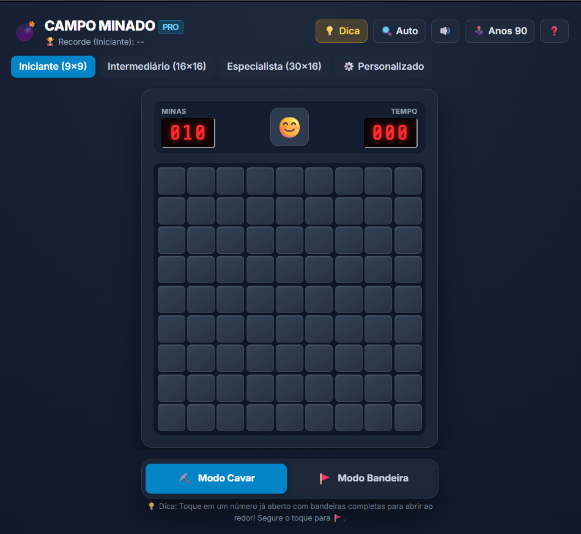

# 💣 Campo Minado Pro

Versão moderna, responsiva e completa do clássico **Campo Minado** (*Minesweeper*), desenvolvida em arquivo único (`index.html`), com suporte nativo para **Desktop** e **Mobile**, áudio sintetizado em tempo real e alternância instantânea entre os temas **Dark Moderno** e **Clássico Anos 90**.

🔗 **Link para execução online:** [https://denis-tek.github.io/jogos/campo-minado/](https://denis-tek.github.io/jogos/campo-minado/)

---

## 📸 Preview

---

## ✨ Funcionalidades e Regras do Jogo

* **1º Clique Sempre Seguro (*Safe First Click*):**
  * As minas são distribuídas apenas após a primeira jogada, garantindo que a célula clicada e seus 8 vizinhos estejam livres para abrir uma clareira inicial baseada em lógica.
* **Abertura em Cascata (*Flood-Fill* BFS) & *Chording*:**
  * Revelação instantânea de áreas vazias adjacentes sem estouro de pilha e abertura rápida ao clicar em números revelados cuja quantidade de bandeiras vizinhas já esteja completa.
* **4 Níveis de Dificuldade Configuráveis:**
  * **Iniciante:** `9 × 9` com `10` minas.
  * **Intermediário:** `16 × 16` com `40` minas.
  * **Especialista:** `30 × 16` com `99` minas.
  * **Personalizado:** de `5 × 5` até `40 × 30` com `1` até `(L × A) - 9` minas.
* **Duplo Tema Visual:**
  * **Dark Moderno:** Interface translúcida com *glassmorphism*, alto contraste e animações fluidas.
  * **Clássico Anos 90:** Visual retrô inspirado no Windows 95 com bordas chanfradas 3D e display digital estilo LED.
* **Controles Otimizados para Desktop & Touch:**
  * **Computador:** Clique esquerdo revela (ou executa *Chording*); clique direito alterna entre **Bandeira (`🚩`)**, **Dúvida (`❓`)** e célula limpa.
  * **Celular / Tablet:** Barra inferior rápida para alternar entre **Modo Cavar (`⛏️`)** e **Modo Bandeira (`🚩`)**, suporte a **Toque Longo (`350ms`)** com vibração tátil e ajuste de zoom (`Auto`, `Grande`, `Compacto`).
* **Dica Inteligente & Recordes Locais:**
  * Identificação de deduções lógicas seguras no tabuleiro e armazenamento automático dos melhores tempos por dificuldade no `localStorage`.

---

## 🛠️ Tecnologias e Algoritmos

* **HTML5 & Tailwind CSS (via CDN) + CSS3 Custom Properties:** Estrutura semântica, layout responsivo *mobile-first* e troca dinâmica entre os temas Dark Moderno e Clássico Anos 90.
* **JavaScript (ES6+):** Busca em largura iterativa (*Flood-Fill* BFS) para abertura de áreas vazias, lógica de *Chording*, motor de deduções lógicas para o sistema de dicas e gerenciamento de gestos *touch* (*Long Press*).
* **Web Audio API (Síntese Procedural):** Efeitos sonoros gerados em tempo real pelo navegador para escavação, cascata, marcação de bandeiras, explosão e fanfarra de vitória, dispensando arquivos externos.
* **Web Storage API (`localStorage`):** Persistência automática dos melhores tempos por nível de dificuldade e preferências visuais/sonoras.