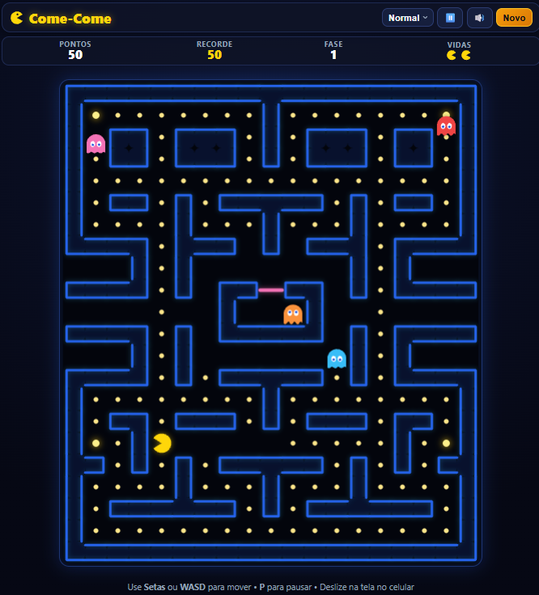

# 🟡 Come-Come (Pac-Man)

[](https://denis-tek.github.io/jogos/come-come/)
[](https://denis-tek.github.io/jogos/)

Uma recriação fiel e responsiva do clássico arcade **Come-Come (Pac-Man)**, desenvolvida em **HTML5 Canvas, CSS3 e JavaScript puro** em um único arquivo (`index.html`), com inteligência artificial individual para os 4 fantasmas, sintetizador de áudio retrô em tempo real e controles híbridos para computador e celular.

🔗 **Jogar online:** [https://denis-tek.github.io/jogos/come-come/](https://denis-tek.github.io/jogos/come-come/)

---

## 🖼️ Preview



---

## ✨ Principais Recursos

### 👻 Inteligência Artificial Clássica dos 4 Fantasmas

Cada fantasma possui uma personalidade de perseguição distinta baseada em máquina de estados, alternando ciclicamente entre os modos **Dispersão (*Scatter*)**, **Perseguição (*Chase*)**, **Assustado (*Frightened*)** e **Capturado (*Eaten*)**:

* **Blinky (Vermelho):** Persegue diretamente a célula atual do Come-Come.
* **Pinky (Rosa):** Tenta emboscar o jogador mirando 4 células à frente da direção atual do Come-Come.
* **Inky (Ciano):** Calcula um vetor combinado entre a posição de *Blinky* e 2 células à frente do Come-Come para fechar rotas de fuga.
* **Clyde (Laranja):** Persegue o jogador quando está distante, mas recua para seu canto do labirinto ao se aproximar a menos de 6 células.

### 🍒 Elementos Clássicos do Labirinto

* **Pastilhas & Pílulas de Poder:** Colete todas as pastilhas (`10 pts`) para avançar de fase. As 4 Pílulas de Poder nos cantos (`50 pts`) deixam os fantasmas azuis e vulneráveis, permitindo capturá-los em sequência com multiplicador progressivo (**`200`**, **`400`**, **`800`** e **`1600` pontos**).
* **Frutas Bônus:** Surgem periodicamente no centro do labirinto (**Cereja `100 pts`**, **Morango `300 pts`**, **Laranja `500 pts`** e **Maçã `700 pts`**) conforme o progresso da fase.
* **Túneis Laterais & Vida Extra:** Teletransporte instantâneo entre as bordas esquerda e direita do labirinto, com bônus automático de **1UP** ao atingir `10.000` pontos.
* **3 Níveis de Dificuldade:** Seletor rápido entre **Fácil**, **Normal** e **Difícil**, ajustando a velocidade das entidades, a duração das pílulas de poder e os intervalos de dispersão.

### 🔊 Áudio Procedural (Web Audio API)

Todo o áudio do jogo é sintetizado dinamicamente em tempo real sem nenhum arquivo `.mp3` ou `.wav` externo:

* Melodia de abertura clássica ao iniciar uma nova partida.
* Efeito *waka-waka* alternado ao devorar pastilhas.
* Sirene de fundo dinâmica que acelera progressivamente conforme o labirinto esvazia (e muda de timbre durante o efeito da Pílula de Poder).
* Efeitos exclusivos para captura de fantasmas, coleta de frutas, perda de vida e conclusão de fase.

---

## 🎮 Controles & Como Jogar

### Computador (Teclado)

| Tecla | Ação |
| :--- | :--- |
| `↑` `↓` `←` `→` ou `W` `A` `S` `D` | Mover o Come-Come (com *Input Buffering* para curvas antecipadas nas esquinas) |
| `P` | Pausar / Retomar a partida |

### Dispositivos Móveis (Touch)

* **Gestos de Deslize (*Swipe*):** Deslize o dedo diretamente sobre a área do labirinto para virar imediatamente ou encadear curvas.
* **D-Pad Tátil:** Controles direcionais responsivos exibidos automaticamente na parte inferior em telas estreitas ou dispositivos sensíveis ao toque.

---

## 📁 Estrutura do Projeto

```text
come-come/
├── index.html      # Aplicação completa autocontida (HTML5 + CSS3 + JS + Web Audio)
├── thumb.svg       # Miniatura vetorial exibida no launcher
├── imagem.png      # Captura de tela do jogo em execução
└── README.md       # Documentação técnica, regras e controles do Come-Come
```

---

## 🛠️ Tecnologias Utilizadas

* **HTML5 Canvas 2D:** Renderização nítida em alta definição (`devicePixelRatio`) das paredes neon conectadas, animações de boca/saiote e popups de pontuação.
* **CSS3 Moderno (`100dvh`):** Interface *zero-scroll* que se adapta automaticamente à altura útil da janela ou tela do celular via `ResizeObserver`.
* **JavaScript (ES6+):** Loop de jogo com delta de tempo estabilizado, navegação em grade com alinhamento suave e persistência automática de recorde e preferências no `localStorage`.
* **Web Audio API:** Síntese sonora polifônica leve diretamente no navegador.

---

## 🚀 Como Executar Localmente

1. Clone este repositório:
   ```bash
   git clone https://github.com/Denis-Tek/jogos.git
   ```
2. Acesse a pasta `come-come/` e abra o arquivo `index.html` diretamente em qualquer navegador moderno (Chrome, Edge, Firefox, Safari ou navegadores móveis).

---

Desenvolvido por **[Denis-Tek](https://github.com/Denis-Tek)**.