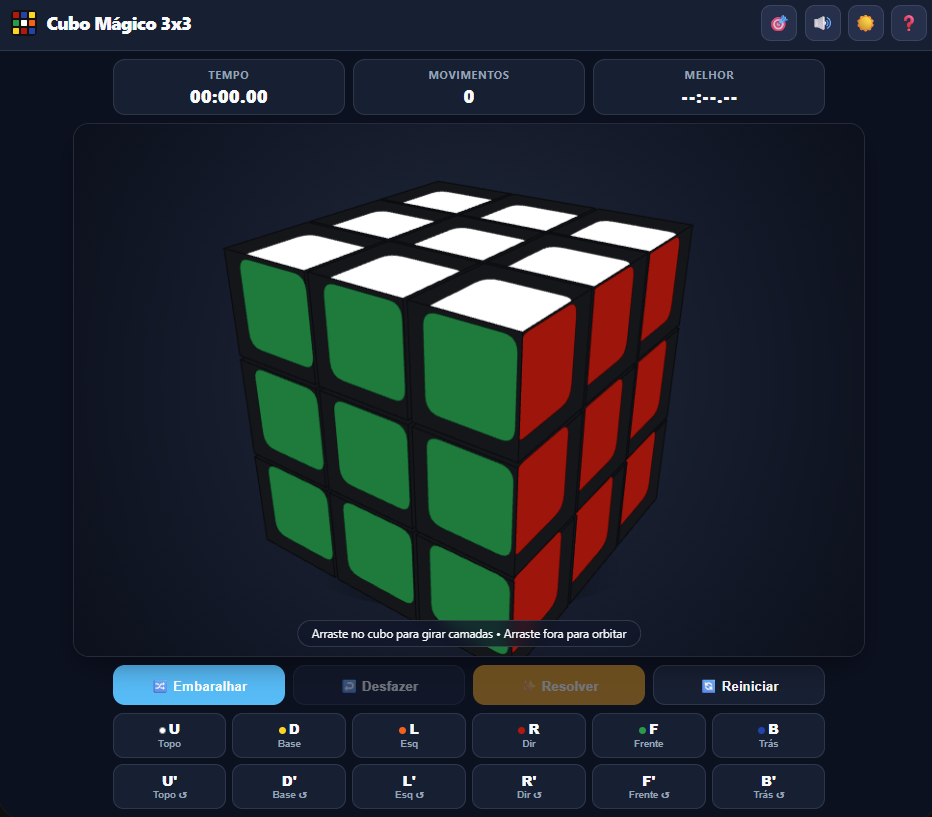

# 🧊 Cubo Mágico 3x3 (Rubik's Cube 3D)

Simulador 3D interativo e autônomo do clássico **Cubo Mágico 3x3** (*Rubik's Cube*), desenvolvido em arquivo único (`index.html`) com motor próprio de projeção 3D em Canvas 2D, cronômetro oficial no estilo *Speedcubing* e efeitos sonoros sintetizados em tempo real.

🔗 **Link para execução online:** [https://denis-tek.github.io/jogos/cubo-magico/](https://denis-tek.github.io/jogos/cubo-magico/)

---

## 📸 Preview

---

## ✨ Funcionalidades e Controles

* **Interação Direta e Intuitiva (Mouse, Toque e Teclado):**
  * **Girar Camadas:** Clique ou toque em qualquer adesivo do cubo e deslize na direção desejada para rotacionar linhas, colunas e camadas centrais.
  * **Órbita 360°:** Arraste fora do cubo para girar a câmera livremente em torno do eixo 3D.
  * **Notação Oficial WCA:** Painel dedicado e atalhos de teclado para os 12 giros oficiais (`U`, `D`, `L`, `R`, `F`, `B` e suas inversas `'` com `Shift`).
* **Cronômetro de Speedcubing & Recordes:**
  * Ao clicar em **Embaralhar** (ou pressionar `Espaço`), o cronômetro entra em modo **PRONTO**, dispara automaticamente no primeiro giro e registra o **Melhor Tempo** no `localStorage` assim que todas as 6 faces forem resolvidas.
* **Ferramentas Auxiliares & Temas:**
  * **Desfazer (`Z`):** Reverte o último movimento realizado.
  * **Resolver (`Auto-Solve`):** Reconstitui a sequência de movimentos passo a passo com animação suave (interruptível a qualquer momento).
  * **Temas Claro e Escuro:** Alternância instantânea de tema visual com opção de silenciar os efeitos sonoros.

---

## 🛠️ Tecnologias e Algoritmos

* **HTML5 Canvas 2D (Pipeline 3D Próprio):** Renderização acelerada sem bibliotecas externas (como Three.js), utilizando matrizes de rotação ortonormais $3\times3$, projeção em perspectiva, *backface culling*, sombreamento direcional, *Painter's Algorithm* e suporte a telas HiDPI / Retina (`devicePixelRatio`).
* **JavaScript (ES6+):** Álgebra vetorial discreta para evitar acúmulo de erro de ponto flutuante nas rotações, além de fila de animações com interpolação *ease-out*.
* **CSS3 Moderno:** Layout responsivo *zero-scroll* (`100dvh`), variáveis dinâmicas para temas claro/escuro e controle nativo de gestos (`touch-action: none`).
* **Web Audio API & `localStorage`:** Síntese procedural dos sons de rotação e fanfarra de conclusão, além de persistência local dos recordes de tempo.