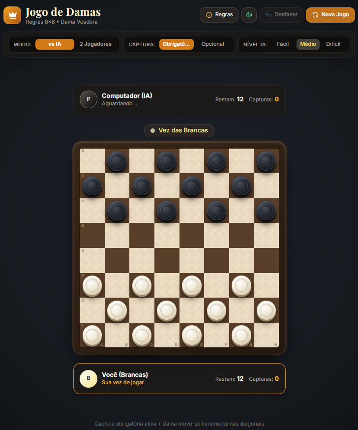

# 👑 Jogo de Damas — Edição de Luxo

Aplicativo web moderno, responsivo e autônomo de **Jogo de Damas (8×8)** desenvolvido em arquivo único (`index.html`), seguindo o padrão das regras brasileiras e internacionais (*Dama Voadora*, *Captura Obrigatória* e *Lei da Maioria*), com suporte a modo casual e inteligência artificial impulsionada por Minimax com poda Alfa-Beta.

🔗 **Link para execução online:** [https://denis-tek.github.io/jogos/damas/](https://denis-tek.github.io/jogos/damas/)

---

## 📸 Preview

---

## ✨ Funcionalidades e Regras do Jogo

* **Motor de Regras Completo (8×8):**
  * **Captura Obrigatória & Lei da Maioria (Modo Oficial):** Tanto o jogador quanto a IA são obrigados a capturar quando houver oportunidade, priorizando sempre a sequência que toma o maior número de peças.
  * **Modo Casual (Captura Opcional):** Seletor rápido no painel superior que permite jogar sem obrigatoriedade de captura (ideal para partidas recreativas).
  * **Capturas Múltiplas em Cadeia:** Suporte completo a saltos consecutivos no mesmo turno, com validação que impede saltar duas vezes sobre a mesma peça e animação passo a passo.
  * **Dama Voadora:** Ao alcançar a última fileira adversária, a pedra é promovida a Dama e passa a mover-se e capturar à distância por toda a extensão das diagonais.
  * **Regra de Empate:** Detecção automática de empate após 40 lances consecutivos sem capturas ou avanço de pedras.

* **Modos de Jogo & Inteligência Artificial:**
  * **vs IA (3 Níveis):** Dificuldades **Fácil**, **Médio** e **Difícil** com avaliação posicional e busca em profundidade.
  * **2 Jogadores (Local):** Modo *passar e jogar* para duas pessoas no mesmo dispositivo.

* **Interface & Experiência Tátil (UX):**
  * Tabuleiro `8×8` responsivo com proporção travada (`aspect-ratio: 1 / 1`), coordenadas algébricas (`A–H`, `1–8`), peças estilizadas em 3D (marfim e ébano), histórico completo de **Desfazer** e guia de regras integrado (incluindo nota histórica sobre a *Regra do Sopro*).

---

## 🛠️ Tecnologias e Algoritmos

* **HTML5 & Tailwind CSS (via CDN) + CSS3 Customizado:** Estrutura semântica, layout responsivo *mobile-first*, gradientes multicamada para o tabuleiro de madeira e relevo 3D das peças.
* **JavaScript (ES6+) — Minimax & DFS:** Arquitetura orientada a objetos (`CheckersGame` e `SoundFX`), busca em profundidade (*DFS*) para validação das cadeias de captura máxima e algoritmo **Minimax com poda Alfa-Beta** para a IA.
* **Web Audio API:** Síntese sonora procedural em tempo real (cliques de madeira, capturas, promoção de dama e vitória) sem arquivos externos.