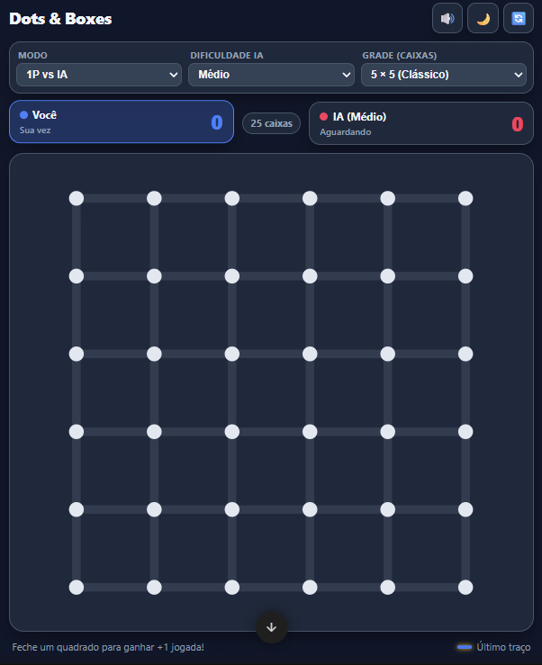

# 🔵 Dots & Boxes (Jogo dos Pontinhos)

Implementação web minimalista e responsiva do clássico jogo de papel e caneta **Dots & Boxes** (*Jogo dos Pontinhos*), desenvolvida em arquivo único (`index.html`) com renderização vetorial em SVG, inteligência artificial adaptativa em 3 níveis e áudio sintetizado em tempo real.

🔗 **Link para execução online:** [https://denis-tek.github.io/jogos/dots-and-bokes/](https://denis-tek.github.io/jogos/dots-and-bokes/)

---

## 📸 Preview

---

## ✨ Funcionalidades e Regras do Jogo

* **Regras Clássicas:**
  * **Traçar Arestas:** Clique ou toque entre dois pontos adjacentes na horizontal ou vertical para desenhar uma linha.
  * **Fechar Caixas e Turno Extra:** Ao completar a quarta parede de um quadrado (`1×1`), você conquista a caixa (marcada com sua cor e sigla), soma **+1 ponto** (ou **+2** em fechamentos duplos) e ganha automaticamente uma **jogada extra**.
  * **Objetivo:** Vence quem conquistar o maior número de caixas quando todas as linhas do tabuleiro forem preenchidas.
* **Modos de Jogo & Inteligência Artificial:**
  * **1P vs IA (3 Níveis):**
    * **Fácil:** Mistura jogadas aleatórias e fechamentos ocasionais.
    * **Médio:** Sempre fecha caixas disponíveis e evita entregar a terceira parede de um quadrado quando há opções seguras.
    * **Difícil:** Prioriza fechamentos duplos, busca arestas seguras (`< 2` paredes) e simula o comprimento das cadeias no tabuleiro para minimizar sacrifícios quando forçada a abrir o jogo.
  * **2 Jogadores:** Modo local (*passar e jogar*) para duas pessoas no mesmo dispositivo.
* **3 Tamanhos de Grade:**
  * **3 × 3 caixas** (`4 × 4` pontos — partida rápida)
  * **5 × 5 caixas** (`6 × 6` pontos — formato clássico)
  * **7 × 7 caixas** (`8 × 8` pontos — partida estratégica)
* **Feedback Visual, Temas & Controles:**
  * Destaque luminoso na última linha traçada para acompanhar facilmente as jogadas da IA, alternância entre **Tema Claro** e **Tema Escuro** e layout responsivo *zero-scroll* (`100dvh`).

---

## 🛠️ Tecnologias e Algoritmos

* **HTML5 & SVG Dinâmico:** Renderização vetorial nítida dos pontos, arestas com área ampliada de toque (`hit-area`) e preenchimento animado das caixas conquistadas.
* **CSS3 Moderno:** Uso de `CSS Grid`, `Flexbox`, variáveis customizadas para temas claro/escuro e dimensionamento fluido em `100dvh`.
* **JavaScript (ES6+) — Heurística de Cadeias:** Gerenciamento de estado da grade, detecção de fechamentos simples/duplos e análise de cadeias (*chains*) para a tomada de decisão da IA no nível Difícil.
* **Web Audio API:** Síntese procedural de efeitos sonoros para traçar linha, fechar caixa e fanfarra de vitória sem arquivos externos.