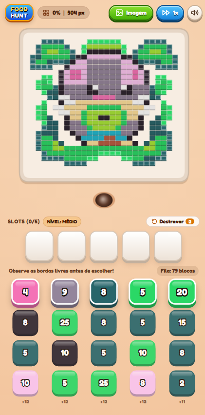

# 🐜 Food Hunt: Formigas Pixeladas


**Food Hunt: Formigas Pixeladas** é um jogo de quebra-cabeça estratégico casual (*puzzle*) desenvolvido inteiramente em um único arquivo HTML5 (`index.html`), utilizando CSS3 e JavaScript nativo (Vanilla JS) sem dependências pesadas.

O jogador gerencia o suprimento de cores em **5 slots ativos** para comandar formigas trabalhadoras que escavam e devoram imagens pixelizadas de fora para dentro, percorrendo exclusivamente caminhos e túneis abertos.

🔗 **Link para execução online:** [https://denis-tek.github.io/jogos/food-hunt/](https://denis-tek.github.io/jogos/food-hunt/)

---

## 🖼️ Preview do Jogo



---

## 🎮 Como Funciona o Jogo

1. **Objetivo:** Devorar 100% dos pixels da imagem na bandeja utilizando os blocos de cores distribuídos nas **5 colunas inferiores**.
2. **Regra de Exposição Real (Bordas e Túneis):** As formigas só conseguem comer os pixels que estão **expostos** — ou seja, conectados por um caminho aberto até a borda externa da bandeja. Pixels no interior do desenho permanecem bloqueados até que as camadas ao redor sejam escavadas.
3. **5 Slots Ativos (Potes):**
   - Ao tocar no bloco do topo de qualquer uma das 5 colunas, ele ocupa um **slot vazio** entre os 5 disponíveis.
   - Blocos da mesma cor **não se somam** no mesmo slot — cada pacote selecionado ocupa seu próprio espaço até ser totalmente consumido.
   - Caso uma cor escolhida não tenha pixels expostos no momento, o pote exibe um **cadeado e borda vermelha**, aguardando que o caminho até aquela cor seja aberto.
4. **Cuidado com o Impasse (*Deadlock*):** Se você preencher todos os **5 slots ativos** com cores que estão soterradas no interior do desenho e não houver nenhuma formiga trabalhando para abrir caminho, o formigueiro trava! Use seus **Destravadores** limitados com sabedoria.

---

## ✨ Principais Funcionalidades

- 📷 **Conversor de Imagens integrado (Upload de Fotos):**
  - Carregue qualquer imagem ou foto diretamente do celular ou computador.
  - Algoritmo **K-Means simplificado** nativo para quantização automática de cores (6, 8 ou 10 cores).
  - Opção de remoção automática de fundo branco/transparente e ajuste de resolução da grade (`20×20`, `26×26` ou `32×32`).
- 🎨 **3 Desenhos Clássicos Inclusos:**
  - *Ratinho na Folha* (`26×26`), *Melancia* (`22×22`) e *Hambúrguer* (`22×22`).
- 🧭 **Pathfinding BFS por Corredores Abertos:**
  - As formigas nunca passam por cima de pixels intactos. Elas utilizam busca em largura (*Breadth-First Search*) para contornar a bandeja e entrar pelos túneis já escavados na ida e na volta ao formigueiro.
- 🐜 **Formigas Camaleão em Estilo 3D:**
  - Cada formiga assume dinamicamente a cor exata do pixel que vai buscar, com sombreamento 3D, brilho especular e animação de patas e antenas no `<canvas>`.
- 🧠 **3 Níveis de Dificuldade Estratégica:**
  - **Fácil:** Camadas suaves e 3 Destravadores.
  - **Médio (Padrão):** Blocos-armadilha do interior intercalados nos topos das colunas e 2 Destravadores.
  - **Difícil (Mestre):** Intercalação profunda de camadas e apenas 1 Destravador.
- 🔢 **Contabilidade 100% Exata:**
  - A soma de todos os blocos distribuídos nas 5 colunas corresponde exatamente à quantidade total de pixels de cada cor na imagem.
- 🔊 **Efeitos Sonoros Sintetizados (Web Audio API):**
  - Sons gerados matematicamente em tempo real pelo navegador, sem necessidade de arquivos `.mp3` ou `.wav` externos.
- 📱 **Design Mobile-First Responsivo:**
  - Interface otimizada para telas sensíveis ao toque, rolagem fluida e controle de velocidade (`1x`, `2x` e `4x`).

---

## 🚀 Como Executar o Projeto Localmente

Como toda a aplicação foi construída seguindo a arquitetura *Single-File*, você não precisa instalar Node.js, compiladores ou servidores:

1. Faça o clone deste repositório:
   ```bash
   git clone https://github.com/denis-tek/jogos.git
   ```
2. Abra o arquivo `index.html` da pasta `food-hunt` diretamente em qualquer navegador moderno (Chrome, Safari, Edge, Firefox) no computador ou celular.

---

## 🛠️ Tecnologias e Algoritmos Utilizados

| Tecnologia / Algoritmo | Aplicação no Jogo |
| :--- | :--- |
| **HTML5 Canvas 2D** | Renderização em 60 FPS da bandeja 3D, pixels chanfrados, partículas e formigas articuladas. |
| **Flood-Fill Perimetral** | Identificação em tempo real de quais espaços vazios possuem conexão com a saída externa. |
| **BFS (Breadth-First Search)** | Cálculo da menor rota ortogonal pelos corredores e túneis abertos para cada formiga. |
| **K-Means Clustering** | Redução e agrupamento inteligente da paleta de cores ao converter fotos enviadas pelo usuário. |
| **Web Audio API** | Síntese de efeitos sonoros de coleta, seleção, alerta de bloqueio, vitória e derrota. |
| **CSS3 + Tailwind CDN** | Estilização 3D dos potes, blocos das colunas, modais responsivos e ícones vetoriais SVG. |