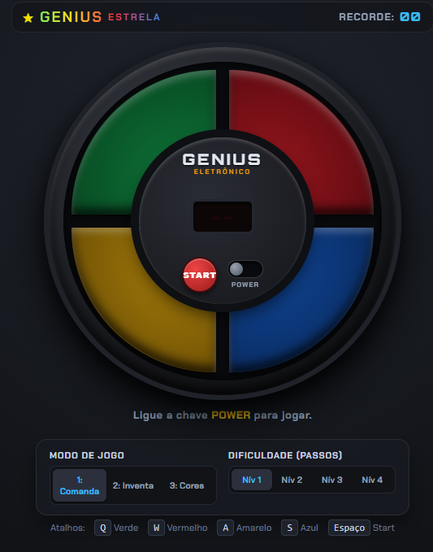

# 🔴🟢 Genius da Estrela 🟡🔵

Recriação digital interativa do icônico brinquedo eletrônico lançado pela **Estrela** no Brasil nos anos 1980 (versão nacional do clássico *Simon*). O projeto reproduz fielmente o visual circular, a resposta tátil dos quatro quadrantes coloridos e as frequências sonoras originais.

🔗 **Link para execução online:** [https://denis-tek.github.io/jogos/genius-estrela/](https://denis-tek.github.io/jogos/genius-estrela/)

---

## 📸 Preview

---

## ✨ Funcionalidades e Regras Clássicas

* **3 Modos de Jogo Originais:**
  1. **Genius Comanda:** O aparelho gera uma sequência aleatória que cresce a cada rodada e acelera progressivamente o ritmo de reprodução.
  2. **O Jogador Inventa:** Modo livre ou competitivo onde os próprios participantes constroem a sequência passo a passo a cada turno.
  3. **Escolha a Sua Cor:** Modo multiplayer onde cada participante assume a responsabilidade por uma ou mais cores específicas durante a sequência.
* **4 Níveis de Dificuldade:** Desafios configuráveis de **8, 14, 20 ou 31 passos** para vencer a memória do aparelho.
* **Controles Híbridos:** Suporte completo a cliques de mouse, telas sensíveis ao toque (*touch*) e atalhos rápidos no teclado (`Q`, `W`, `A`, `S` ou setas direcionais).
* **Placar e Recorde Persistente:** Visor digital estilo LED de 7 segmentos com armazenamento automático da maior pontuação no `localStorage`.

---

## 🛠️ Tecnologias e Implementação

* **HTML5 & CSS3 (Geometria em Arco):** Construção dos quatro botões em formato de setores circulares com efeitos de iluminação interna (`box-shadow` e gradientes radiais) que simulam lâmpadas incandescentes sob acrílico translúcido.
* **Web Audio API (Síntese Harmônica):** Geração procedural das quatro notas musicais distintas para cada cor, além do tom grave descendente de erro e da fanfarra de conclusão.
* **JavaScript Assíncrono:** Controle preciso de temporização (`setTimeout` / `Promise`) para sincronizar o acendimento visual, a emissão sonora e o bloqueio de entrada durante a demonstração da máquina.