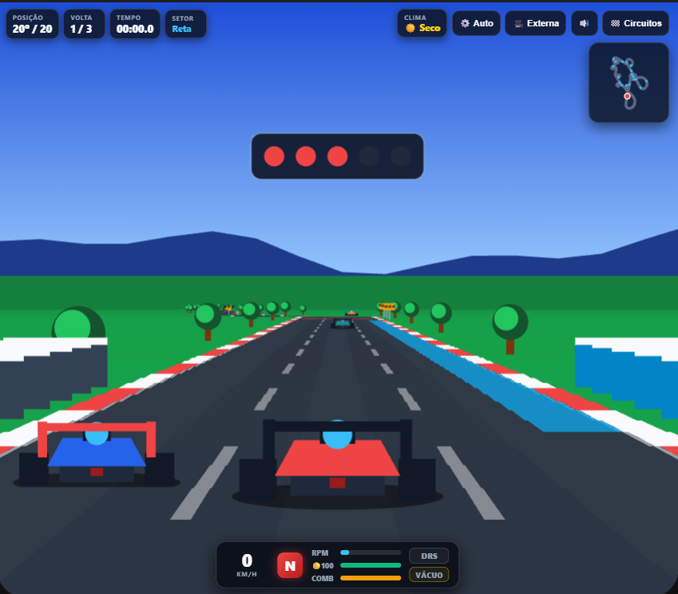

# 🏎️ Grand Prix 3D — Simulador de Fórmula 1

[](https://denis-tek.github.io/jogos/grand-prix-3d/)
[](https://denis-tek.github.io/jogos/)
[](#tecnologias-utilizadas)
[](#tecnologias-utilizadas)
[](#tecnologias-utilizadas)
[](#tecnologias-utilizadas)

Um simulador de corrida de Fórmula 1 em estilo **Pseudo-3D clássico (*OutRun / Pole Position*)**, responsivo e desenvolvido em **HTML5 Canvas, CSS3 e JavaScript puro** em arquivo único (`index.html`) integrado a um banco externo de pistas (`circuitos.json`), com duas câmeras (Externa e Cockpit), estratégia de Pit Stop, clima dinâmico e controles híbridos para desktop e dispositivos móveis.

🔗 **Jogar Online:** [https://denis-tek.github.io/jogos/grand-prix-3d/](https://denis-tek.github.io/jogos/grand-prix-3d/)



---

## ✨ Principais Recursos

### 🗺️ 4 Circuitos Configuráveis via JSON (`circuitos.json`)
As pistas, paletas de cores, setores, curvas e inclinações são carregados dinamicamente de `circuitos.json` (com *fallback* embutido no `index.html` para execução direta via `file://`):
- **Interlagos (Brasil)** — `4,309 km` • 13 setores • Dificuldade: *Médio*
- **Monte Carlo (Mônaco)** — `3,337 km` • 14 setores • Dificuldade: *Difícil*
- **Monza (Itália)** — `5,793 km` • 11 setores • Dificuldade: *Fácil*
- **Silverstone (Reino Unido)** — `5,891 km` • 15 setores • Dificuldade: *Médio* (alta probabilidade de chuva)

### 🎥 Dupla Câmera em Tempo Real (`C`)
Alterne a qualquer momento entre duas perspectivas completas:
- **Câmera Externa (Traseira):** Visão clássica atrás do monoposto com inclinação lateral dinâmica nas curvas, partículas de fumaça/spray nas derrapagens e linhas de vento aerodinâmico.
- **Câmera de Cockpit (Piloto):** Visão interna com bico do carro, suspensão dianteira, **rodas dianteiras esterçando** em tempo real (com faixa colorida do composto ativo), espelhos retrovisores, **Halo** de proteção e **volante interativo** com LEDs de RPM e visor digital de marcha e velocidade.

### ⚙️ Mecânicas Completas de Fórmula 1
- **Física Lateral & Alerta Antecipado de Curvas:** Força centrífuga proporcional à velocidade e aderência, exigindo frenagem nas zonas vermelhas (*braking zones*) e esterço ativo, auxiliado por setas direcionais pulsantes com sugestão de marcha ideal (`M2`, `M3`, `M4`).
- **DRS / Turbo & Efeito de Vácuo (*Slipstream*):** Ative a asa traseira móvel (`DRS`) nas retas para ganhar impulso extra ou alinhe-se atrás de um carro rival para aproveitar o vácuo (`+15 km/h`) e efetuar ultrapassagens.
- **Pit Stop Interativo & Compostos de Pneu:** Encoste na faixa azul dos boxes (*Pit Lane*) na reta principal para reabastecer e escolher o composto de pneu ideal em 1 toque:
  - 🔴 **Macio:** Maior velocidade máxima e aderência no seco, com desgaste acelerado.
  - 🟡 **Médio:** Equilíbrio ideal entre ritmo e durabilidade.
  - 🔵 **Chuva:** Aderência superior em pista molhada para evitar derrapagens.
- **Câmbio Automático ou Manual (6 Marchas):** Alternável em tempo real no HUD superior, com indicador luminoso de troca (*Shift Light*) e borboletas táteis **`M-` / `M+`** no mobile.
- **Clima Dinâmico, Minimapa 2D & IA Competitiva:** Alternância entre pista seca e chuva durante a corrida, minimapa vetorial 2D em tempo real com a posição dos 20 carros, áudio procedural multicanal via **Web Audio API** (motor V6, vibração nas zebras, chiado de pneus e vento aerodinâmico) e recordes salvos no `localStorage`.

---

## 🎮 Controles

### Computador (Teclado)
| Tecla | Ação |
| :--- | :--- |
| `↑` ou `W` | Acelerar |
| `↓` ou `S` | Frear |
| `←` / `→` ou `A` / `D` | Esterçar para esquerda / direita |
| `Espaço` | Ativar **DRS / Turbo** |
| `X` / `Z` (ou `Shift` / `Ctrl`) | Subir (`M+`) / Reduzir (`M-`) marcha (no modo **Manual**) |
| `C` | Alternar câmera (**Externa** / **Cockpit**) |

### Dispositivos Móveis e Touch
| Controle na Tela | Ação |
| :--- | :--- |
| `◀` / `▶` (Inferior Esquerdo) | Esterçar para esquerda / direita |
| `M-` / `M+` (Borboletas Laterais) | Reduzir / Subir marcha (exibidas automaticamente no modo **Manual**) |
| `⚡` (Botão Verde) | Acelerar |
| `🛑` (Botão Vermelho) | Frear |
| `DRS` (Botão Azul) | Ativar **DRS / Turbo** |

---

## 📁 Estrutura do Projeto

```text
grand-prix-3d/
├── index.html       # Aplicação completa autocontida (HTML5 + CSS3 + Motor Pseudo-3D + Web Audio)
├── circuitos.json   # Configuração externa dos 4 circuitos, setores, inclinações e paletas de cores
├── imagem.png       # Captura de tela do jogo em execução
└── README.md        # Documentação do projeto
```

---

## 🚀 Como Executar Localmente

1. Clone este repositório:
   ```bash
   git clone https://github.com/Denis-Tek/jogos.git
   ```
2. Acesse a pasta `grand-prix-3d/`:
   - **Via Servidor Local / GitHub Pages (recomendado):** Inicie um servidor estático simples (como a extensão *Live Server* no VS Code ou `python -m http.server`) para permitir a leitura dinâmica de `circuitos.json`.
   - **Direto no Navegador:** Também é possível abrir o `index.html` diretamente no navegador graças ao banco sincronizado de circuitos embutido.

---

## 🛠️ Tecnologias Utilizadas

- **HTML5 Canvas 2D:** Renderização pseudo-3D em 60 FPS com projeção em perspectiva, *Painter's Algorithm*, minimapa vetorial 2D e painel de cockpit detalhado.
- **CSS3 Moderno:** Layout responsivo em tela cheia (`100dvh`), `backdrop-filter`, variáveis de tema e controles multi-touch sem rolagem.
- **JavaScript (ES6+):** Física lateral e longitudinal, IA de tráfego com mudança de faixa, carregamento assíncrono via `fetch` com *fallback* local e persistência via `localStorage`.
- **JSON (`circuitos.json`):** Estruturação modular das pistas, paletas de cores, setores e inclinações.
- **Web Audio API:** Motor de síntese sonora multicanal em tempo real sem dependência de arquivos externos de áudio.

---

Desenvolvido por **[Denis-Tek](https://github.com/Denis-Tek)**.
