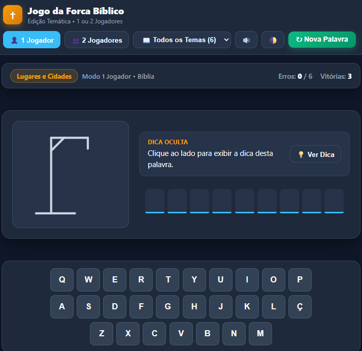

# ✝ Jogo da Forca Bíblico

[](https://denis-tek.github.io/jogos/jogo-da-forca/)
[](#tecnologias-utilizadas)
[](#tecnologias-utilizadas)
[](#tecnologias-utilizadas)
[](#estrutura-do-projeto)

Uma versão temática, educativa e responsiva do clássico **Jogo da Forca**, desenvolvida em **HTML5, CSS3 e JavaScript puro** com banco de dados externo editável (`palavras.json`) contendo palavras, categorias, dicas e referências bíblicas.

🔗 **Jogar online:** [https://denis-tek.github.io/jogos/jogo-da-forca/](https://denis-tek.github.io/jogos/jogo-da-forca/)



---

## ✨ Principais Recursos

### 📖 Modo 1 Jogador (Temas Bíblicos)
- **5 Categorias Temáticas (ou "Todos os Temas"):**
  - *Personagens*
  - *Livros da Bíblia*
  - *Lugares e Cidades*
  - *Objetos e Símbolos*
  - *Eventos e Milagres*
- **Banco de Dados Externo (`palavras.json`):** Carregado automaticamente na inicialização, permitindo adicionar, editar ou remover palavras, dicas e versículos de referência sem alterar o código da aplicação.
- **Sorteio Inteligente sem Repetição:** Garante que todas as palavras da categoria selecionada sejam jogadas antes de repetir.
- **Dica Sob Demanda & Referência Bíblica:** Botão **💡 Ver Dica** durante a partida e exibição automática da referência bíblica ao concluir a rodada.

### 👥 Modo 2 Jogadores (Desafio Personalizado)
- **Entrada Secreta Protegida:** Campo de senha (com opção de alternar visibilidade) para o Jogador 1 digitar a palavra ou expressão composta sem que o Jogador 2 veja.
- **Tema e Dica Customizados:** Permite informar o tema relacionado e uma dica auxiliar que ficam visíveis durante toda a rodada.

### ⚙️ Mecânicas e Acessibilidade
- **Normalização Automática de Acentos:** Ao selecionar uma vogal (ex: `A`), todas as variações acentuadas (`Á`, `À`, `Ã`, `Â`) são reveladas automaticamente, mantendo a tecla `Ç` dedicada.
- **Suporte a Expressões Compostas:** Espaços e hífens são formatados automaticamente no tabuleiro.
- **Teclado Híbrido & Áudio Procedural:** Funciona tanto pelo teclado virtual na tela quanto pelo teclado físico, com efeitos sonoros sintetizados via **Web Audio API**, alternância de **Tema Escuro / Claro** e registro local de vitórias (`localStorage`).

---

## 🎮 Como Jogar

1. **Escolha o Modo:** Selecione **👤 1 Jogador** (e filtre pelo tema bíblico desejado) ou **👥 2 Jogadores** para criar um desafio personalizado.
2. **Adivinhe as Letras:** Clique nas teclas virtuais ou digite no teclado físico para revelar as letras da palavra secreta.
3. **Atenção às Tentativas:** Cada letra incorreta desenha uma parte do boneco na forca — você tem até **6 tentativas** antes do fim da rodada.

---

## 🚀 Como Executar

1. Clone este repositório:
   ```bash
   git clone https://github.com/Denis-Tek/jogos.git
   ```
2. Acesse a pasta `jogo-da-forca/` e sirva os arquivos por meio de um servidor HTTP local (como a extensão *Live Server* do VS Code ou `python -m http.server`) para que o navegador carregue o arquivo `palavras.json` via `fetch`.

---

## 📁 Estrutura do Projeto

```text
jogo-da-forca/
├── index.html      # Aplicação principal (HTML5 + CSS3 + JS + SVG + Web Audio)
├── palavras.json   # Banco de dados editável com palavras, categorias, dicas e referências
├── imagem.png      # Captura de tela do jogo em execução
└── README.md       # Documentação do projeto
```

---

## 🛠️ Tecnologias Utilizadas

- **HTML5 & SVG Inline:** Estrutura semântica e ilustração vetorial progressiva da forca.
- **CSS3 Moderno:** Design responsivo com variáveis CSS para alternância instantânea entre tema escuro e claro.
- **JavaScript (ES6+):** Carregamento assíncrono (`Fetch API`), normalização Unicode (`NFD`), gerenciamento de estado e persistência local.
- **Web Audio API:** Síntese sonora nativa sem arquivos externos de áudio.