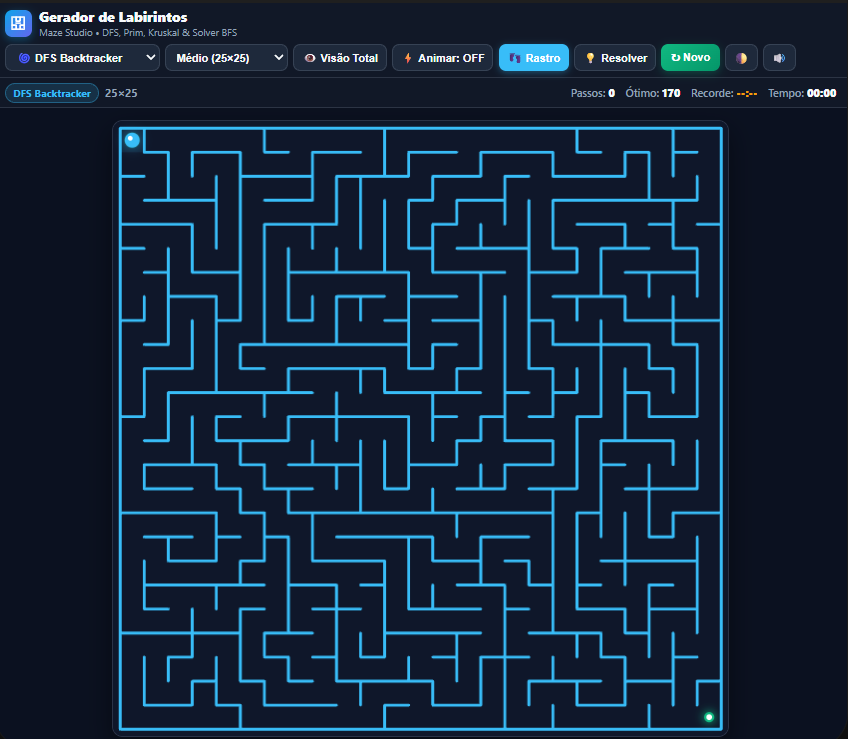

# 🧭 Gerador de Labirintos (Maze Studio)

[](https://denis-tek.github.io/jogos/labirinto/)
[](https://denis-tek.github.io/jogos/)

Uma implementação interativa e educativa de **Gerador e Solucionador de Labirintos** desenvolvida em **HTML5, CSS3 e JavaScript puro** em um único arquivo (`index.html`), combinando geração procedural por algoritmos clássicos de grafos, visualização em tempo real, modo Névoa de Guerra e busca de caminho ótimo.

---

## 🖼️ Preview



---

## ✨ Principais Recursos

- **3 Algoritmos Clássicos de Geração Procedural:**
  - **DFS (Recursive Backtracker):** Cria corredores longos, profundos e sinuosos com poucas ramificações curtas.
  - **Prim's Algorithm:** Gera labirintos orgânicos com muitas bifurcações curtas e becos sem saída frequentes.
  - **Kruskal's Algorithm (Union-Find):** Constrói caminhos bem distribuídos e equilibrados por toda a grade.
- **Construção Animada em Tempo Real (`⚡ Animar`):** Permite alternar entre geração instantânea ou assistir passo a passo ao algoritmo escavando as paredes do labirinto.
- **Solucionador Visual Inteligente (`💡 Resolver`):** Executa **Busca em Largura (BFS)** a partir da posição atual do jogador até a saída, animando primeiro a frente de onda explorada e iluminando em seguida a rota ótima restante.
- **Modo Névoa de Guerra (`🔦`):** Iluminação radial dinâmica ao redor do personagem (efeito lanterna), ocultando o restante do mapa para aumentar o desafio de exploração.
- **3 Tamanhos de Grade:**
  - **Pequeno (`15×15`):** Partidas rápidas ideais para dispositivos móveis.
  - **Médio (`25×25`):** Equilíbrio entre exploração e visibilidade.
  - **Grande (`37×37`):** Labirintos complexos para desafios prolongados.
- **Rastro de Exploração & Recordes Locais:** Marcação opcional dos passos já percorridos (com botão para limpar o rastro) e salvamento automático dos melhores tempos no `localStorage` por tamanho de grade e modo de visão.
- **Áudio Procedural & Temas:** Efeitos sonoros sintetizados via **Web Audio API** (sem arquivos externos) e alternância entre **Tema Escuro** e **Tema Claro** em layout responsivo *zero-scroll* (`100dvh`).

---

## 🎮 Controles & Como Jogar

O objetivo é guiar o explorador do ponto de partida (canto superior esquerdo) até o portal de saída (canto inferior direito) no menor tempo e número de passos possível:

| Ação | Desktop (Teclado / Mouse) | Mobile (Toque) |
| :--- | :--- | :--- |
| **Mover Personagem** | `Setas Direcionais` ou `W A S D` | Deslize (*Swipe*) no tabuleiro ou use o **D-Pad** |
| **Novo Labirinto** | Botão **Novo** ou tecla `N` | Toque no botão **Novo** |
| **Solucionador BFS** | Botão **💡 Resolver** ou tecla `H` | Toque no botão **💡** |
| **Névoa de Guerra** | Botão **🔦** ou tecla `F` | Toque no botão **🔦** |

---

## 📁 Estrutura do Projeto

```text
labirinto/
├── index.html      # Aplicação completa autocontida (HTML5 + CSS3 + JS + Canvas + Web Audio)
├── thumb.svg       # Miniatura vetorial para o launcher principal do repositório
├── imagem.png      # Captura de tela do jogo em execução
└── README.md       # Documentação do projeto