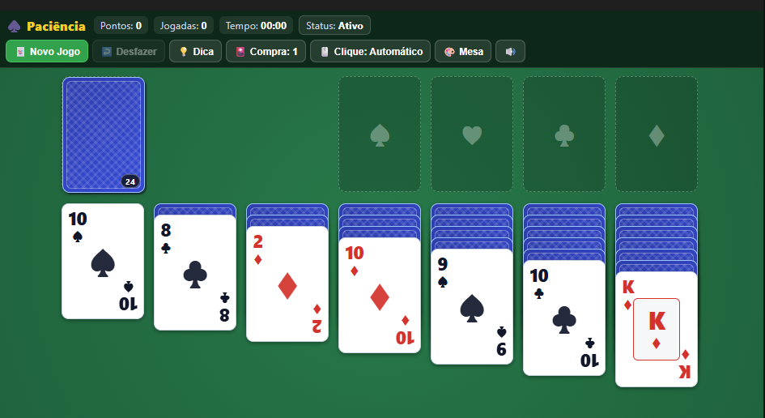

# ♠️ Paciência Clássica (Klondike Solitaire)

Versão moderna, responsiva e totalmente em português do clássico **Paciência Klondike**, desenvolvida em arquivo único (`index.html`), com suporte nativo a mouse e telas sensíveis ao toque, layout *zero-scroll* e motor inteligente de análise de jogadas e detecção de impasses.

🔗 **Link para execução online:** [https://denis-tek.github.io/jogos/paciencia/](https://denis-tek.github.io/jogos/paciencia/)

---

## 📸 Preview

---

## ✨ Funcionalidades e Regras do Jogo

* **Regras Clássicas do Klondike:**
  * **Objetivo:** Mover todas as 52 cartas para as **4 fundações superiores**, organizadas por naipe em ordem crescente do **Ás ao Rei** ($\text{A} \to \text{K}$).
  * **Tableau (Mesa):** As **7 colunas** aceitam cartas em ordem decrescente com **cores alternadas** (cartas vermelhas sobre pretas e vice-versa); colunas vazias aceitam exclusivamente **Reis ($\text{K}$)**.
  * **Monte de Compras:** Suporte à compra de **1 carta** ou **3 cartas** por vez, com reciclagem contínua do descarte.
* **Controles Flexíveis e Intuitivos:**
  * **Modo Automático (1 Clique):** Move a carta selecionada diretamente para o melhor destino válido.
  * **Modo Selecionar e Mover:** Destaca a carta escolhida antes de selecionar a coluna ou fundação de destino.
  * **Arrastar e Soltar (*Drag & Drop*) e Duplo Clique:** Movimentação fluida com carta fantasma (*ghost*) e envio rápido às fundações.
* **Dicas Inteligentes & Detecção de Impasse (*Deadlock Solver*):**
  * O botão **💡 Dica** consulta a árvore real de jogadas válidas para apontar o próximo passo de progresso.
  * Um solucionador interno alerta matematicamente quando a partida entra em um ciclo sem saída.
* **Recursos de Partida & Personalização:**
  * Histórico completo de **Desfazer**, botão **⚡ Autocompletar** (habilitado assim que todas as cartas ocultas são viradas), cronômetro, contador de jogadas, pontuação clássica e temas **Esmeralda Clássico** e **Feltro Meia-Noite**.

---

## 🛠️ Tecnologias e Algoritmos

* **HTML5 & CSS3 Fluido (`ResizeObserver`):** Cálculo dinâmico de dimensões via variáveis CSS para adaptar cartas, colunas e fundações a qualquer tela sem barras de rolagem (*zero-scroll*).
* **JavaScript (ES6+) — Solver BFS com Tabela de Transposição:** Algoritmo de busca em largura (*Breadth-First Search*) com podas de simetria para validar caminhos de solução, gerar dicas precisas e detectar *deadlocks*.
* **Pointer Events API:** Gerenciamento unificado de toque, clique, duplo clique e arrasto em dispositivos móveis e desktops.
* **Web Audio API & `localStorage`:** Síntese procedural de efeitos sonoros de cartas sem arquivos externos e persistência local das preferências de tema, som e modo de interação.