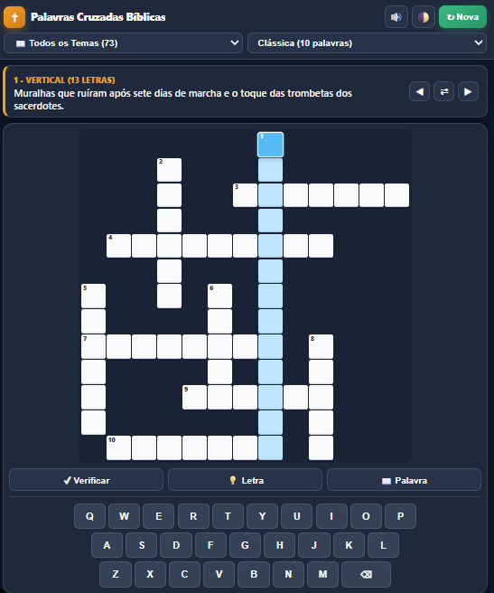

# ✝️ Palavras Cruzadas Bíblicas

[](https://denis-tek.github.io/jogos/palavras-cruzadas/)
[](https://denis-tek.github.io/jogos/)

Um passatempo educativo e interativo de **Palavras Cruzadas Bíblicas** desenvolvido em **HTML5, CSS3 e JavaScript puro** (sem dependências externas), com **geração dinâmica de grades por interseção**, banco de dados externo editável (`palavras.json`) e layout responsivo adaptado tanto para dispositivos móveis quanto para desktop.

🔗 **Link para execução online:** [https://denis-tek.github.io/jogos/palavras-cruzadas/](https://denis-tek.github.io/jogos/palavras-cruzadas/)

---

## 🖼️ Preview



---

## ✨ Principais Recursos

- **Gerador Procedural de Grades Dinâmicas:** Constrói cruzamentos inéditos a cada partida ao clicar em **↻ Nova**, sorteando a palavra-âncora, alternando a orientação inicial (`Horizontal` ou `Vertical`), aplicando desempate aleatório nas interseções e evitando repetir a assinatura da última grade gerada.
- **3 Níveis de Tamanho:**
  - **Compacta:** `7` palavras (ideal para partidas rápidas no celular)
  - **Clássica:** `10` palavras
  - **Desafio:** `13` palavras
- **Banco de Dados Bíblico Editável (`palavras.json`):** `73` palavras cadastradas em `6` categorias temáticas (*Personagens*, *Eventos e Milagres*, *Doutrinas e Ensinamentos*, *Livros da Bíblia*, *Lugares e Cidades* e *Objetos e Símbolos*), com carregamento híbrido (`fetch('./palavras.json')` + cópia sincronizada embutida) e normalização ortográfica automática.
- **Barra Fixa de Dica Ativa:** Exibe no topo o número, a direção (`Horizontal` ou `Vertical`), a quantidade de letras e a pista da palavra selecionada no momento, com navegação rápida (`◀`, `⇄`, `▶`).
- **Teclado Virtual Integrado & Teclado Físico:** Teclado posicionado diretamente abaixo do tabuleiro no mobile (evitando que o teclado nativo do sistema comprima a tela), além de suporte completo a teclado físico no desktop.
- **Ferramentas de Apoio em Linha Única:** Botões **✔ Verificar** (destaca acertos em verde e erros em vermelho), **💡 Letra** (revela a célula atual) e **📖 Palavra** (completa a palavra ativa).
- **Áudio Procedural & Temas:** Efeitos sonoros sintetizados via **Web Audio API** (com botão de mudo `🔊`/`🔇`) e alternância instantânea entre **Tema Escuro** e **Tema Claro** (`🌓`).

---

## 🎮 Como Jogar

1. **Escolha o Tema e o Tamanho:** No cabeçalho superior, selecione uma categoria bíblica específica (ou *Todos os Temas*) e o tamanho da grade (`7`, `10` ou `13` palavras).
2. **Selecione uma Palavra:** Toque ou clique em qualquer célula branca do tabuleiro (ou em uma pista na lista lateral). Toque novamente na mesma célula de cruzamento — ou no botão `⇄` — para alternar entre **Horizontal** e **Vertical**.
3. **Preencha as Letras:** Use o teclado virtual na base do tabuleiro ou digite diretamente no teclado físico:
   - **Letras (`A–Z`):** Preenchem a célula atual e avançam automaticamente para o próximo espaço vazio da palavra.
   - **Setas Direcionais (`↑`, `↓`, `←`, `→`):** Movem o cursor pelo tabuleiro.
   - **`Tab` / `Shift + Tab`:** Avançam ou retrocedem entre as palavras da grade.
   - **`Backspace` / `Delete`:** Apagam a letra atual e recuam o cursor.
4. **Conclua a Grade:** Ao preencher todas as palavras corretamente, uma janela de celebração exibe o resumo completo com as **referências bíblicas** de cada resposta para leitura e estudo.

---

## 📁 Estrutura do Projeto

```text
palavras-cruzadas/
├── index.html      # Aplicação completa (HTML5 + CSS3 + JS + Gerador + Web Audio)
├── palavras.json   # Banco de dados externo com 73 palavras, dicas e referências bíblicas
├── thumb.svg       # Miniatura vetorial exibida no launcher principal
├── imagem.png      # Captura de tela do jogo em execução
└── README.md       # Documentação do projeto
```

---

## 🛠️ Tecnologias Utilizadas

- **HTML5 Semântico:** Estrutura acessível com atributos ARIA (`role="grid"`, `aria-modal`, `aria-live`).
- **CSS3 Moderno:** Custom Properties para temas (`Dark` / `Light`), CSS Grid, Flexbox e responsividade dinâmica.
- **JavaScript (ES6+):** Algoritmo de geração procedural de palavras cruzadas por interseção com validação de adjacências, normalização Unicode (`NFD`) e observação de redimensionamento (`ResizeObserver`).
- **Web Audio API:** Síntese sonora em tempo real sem dependência de arquivos `.mp3` ou `.wav`.

---

## 🚀 Como Executar Localmente

1. Clone este repositório:
   ```bash
   git clone https://github.com/Denis-Tek/jogos.git
   ```
2. Inicie um servidor HTTP simples na pasta raiz `jogos/` (ex.: `python -m http.server 8000`) e acesse `http://localhost:8000/palavras-cruzadas/`.

---

Desenvolvido por **[Denis-Tek](https://github.com/Denis-Tek)**.
