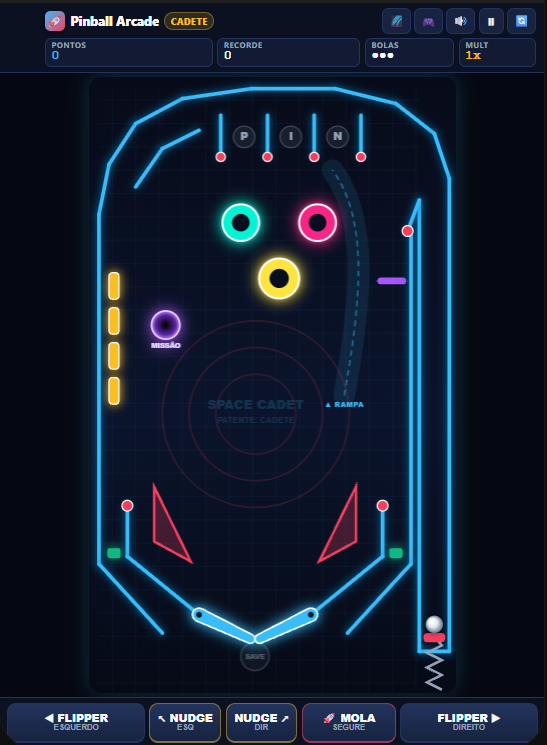

# 🕹️ Pinball Arcade — Edição Space Cadet

[](https://denis-tek.github.io/jogos/pinball/)
[](https://denis-tek.github.io/jogos/)

Recriação moderna do clássico pinball de fliperama inspirada no icônico *3D Pinball for Windows – Space Cadet*, desenvolvida em arquitetura **Single-File** (HTML5 Canvas 2D + CSS3 + JavaScript puro) com motor de física *sub-stepped* livre de travamentos, sistema de missões e patentes, controles híbridos e áudio sintetizado em tempo real via **Web Audio API**.

🔗 **Acesse Online:** [https://denis-tek.github.io/jogos/pinball/](https://denis-tek.github.io/jogos/pinball/)

---

## 🖼️ Preview



---

## ✨ Principais Recursos

* **Motor de Física 2D Sub-stepped (8 passos por frame):** Garante colisões contínuas em alta velocidade sem atravessamento (*tunneling*), transferência angular realista nos *flippers* para tiros cruzados, gravidade de mesa inclinada e detector automático *anti-stuck*.
* **Geometria Livre de Travamentos:** Corredores internos (*inlanes*) contínuos até os pivôs dos *flippers*, pinos elásticos arredondados (*rubber posts*) nas divisórias, **Kickbacks** automáticos de resgate nos corredores externos e **Ball Saver** temporizado após cada lançamento.
* **Elementos Clássicos & Sistema de Patentes:**
  * **Buraco de Missão / Wormhole:** Captura a esfera por `0,85s`, promove a patente do jogador (**Cadete → Tenente → Capitão → Comandante → Almirante**) e a ejeta em alta velocidade.
  * **Pistas Superiores `P - I - N` & Skill Shot:** Acenda as três letras para elevar o multiplicador (`1x` → `2x` → `3x` → `5x`) ou acerte a pista piscante logo no lançamento para bônus imediato.
  * **4 Drop Targets & Modo MULTIBALL:** Derrube os quatro alvos da lateral esquerda para ganhar **+2.500 pts** e liberar **2 bolas extras simultâneas** na mesa.
  * **Rampa Elevada Curva, Pop Bumpers, Slingshots & Spinner:** Rebotes energizados, roleta de órbita e bônus progressivos de rampa.
* **Duplo Tema Visual & Áudio Procedural:** Alternância instantânea entre **🌌 Neon Arcade** e **🕹️ Clássico Retrô**, recorde persistente no `localStorage` e síntese sonora completa via **Web Audio API** (sem arquivos externos).

---

## 🎮 Controles & Como Jogar

| Ação | Teclado (Desktop) | Toque / Mouse (Mobile & Desktop) |
| :--- | :--- | :--- |
| **Flipper Esquerdo** | `Seta Esquerda` (`←`), `Z` ou `A` | Toque na **metade esquerda** da mesa (ou botão `◀ FLIPPER`) |
| **Flipper Direito** | `Seta Direita` (`→`), `M`, `/` ou `D` | Toque na **metade direita** da mesa (ou botão `FLIPPER ▶`) |
| **Lançador (Mola)** | Segure `Espaço` ou `Seta Baixo` (`↓`) | **Arraste o êmbolo** no canal direito (ou segure `🚀 MOLA`) |
| **Empurrão (Nudge / Tilt)** | `W` / `↑` (Frente), `Q` (Esq.), `E` (Dir.) | Botão `⚡ MESA` (com aviso progressivo antes do `TILT`) |
| **Pausar / Barra Tátil** | `P` ou `Esc` | Botões `⏸` e `🎮` no cabeçalho superior |

---

## 📁 Estrutura do Projeto

```text
pinball/
├── index.html   # Aplicação completa autocontida (HTML5 + CSS3 + JS + Canvas 2D + Web Audio)
├── thumb.svg    # Miniatura vetorial exibida no launcher principal
├── imagem.png   # Captura de tela do jogo em execução
└── README.md    # Documentação técnica, controles e mecânicas do Pinball Arcade