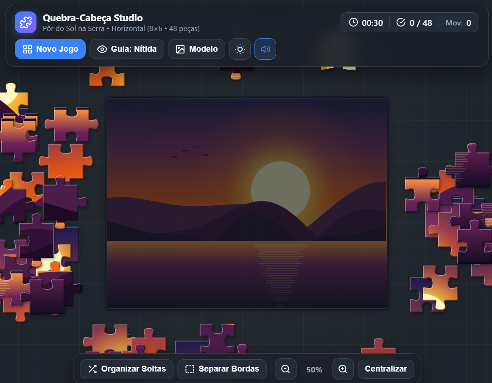

# 🧩 Quebra-Cabeça Studio

Um jogo de **Quebra-Cabeça (Jigsaw Puzzle)** interativo, responsivo e autocontido desenvolvido em **arquivo único (`index.html`)** sem dependências externas, com motor de recorte realista por curvas de Bézier, galeria procedural em alta definição e suporte a fotos próprias em qualquer proporção.

🔗 **Link para execução online:** [https://denis-tek.github.io/jogos/quebra-cabeca/](https://denis-tek.github.io/jogos/quebra-cabeca/)

## 📸 Preview



## ✨ Funcionalidades e Regras do Jogo

* **Recorte Realista por Curvas de Bézier:**
  * Peças pré-renderizadas em alta densidade (DPI) com encaixes machos e fêmeas complementares, bordas chanfradas iluminadas e sombra interna para efeito físico 3D.
* **Agrupamento Magnético (*Snapping*):**
  * Peças vizinhas encaixadas se fundem automaticamente em um único bloco móvel com flash visual de confirmação e feedback sonoro.
* **Carrossel de Ilustrações Procedurais & Fotos Próprias:**
  * **8 Cenários Procedurais:** *Pôr do Sol na Serra* (`4:3`), *Farol sob a Lua* (`3:4`), *Cachoeira & Cerejeiras* (`3:4`), *Mandala Cósmica* (`1:1`), *Noite Neon* (`4:3`), *Vitral Geométrico* (`4:3`), *Jardim Botânico* (`4:3`) e *Mosaico Bauhaus* (`1:1`).
  * **Upload Local de Fotos:** Carregue qualquer imagem (`.jpg`, `.png`, `.webp`) diretamente no navegador — sem envio para servidores — com detecção automática da orientação original ou recorte opcional (`Original`, `Horizontal 4:3`, `Vertical 3:4` e `Quadrado 1:1`).
* **4 Níveis de Dificuldade & Modo Rotação (`90°`):**
  * **Fácil:** ~24 peças (`6×4`, `4×6` ou `5×5`)
  * **Médio:** ~48 peças (`8×6`, `6×8` ou `7×7`)
  * **Difícil:** ~96 peças (`12×8`, `8×12` ou `10×10`)
  * **Mestre:** ~150 peças (`15×10`, `10×15` ou `12×12`)
  * **Modo Rotação:** Opção para iniciar as peças rotacionadas em múltiplos de `90°` (gire com toque rápido, clique direito ou tecla `R`).
* **Ferramentas de Mesa & Navegação:**
  * Imagem guia translúcida ajustável no fundo da moldura, botões para **Separar Bordas** ou **Organizar Soltas**, zoom suave com suporte a pinça *multi-touch*, temas **Escuro / Claro** e salvamento local dos recordes de tempo.

## 🛠️ Tecnologias e Algoritmos

* **HTML5 Canvas 2D:** Renderização *offscreen* das peças em alta densidade, máscaras de recorte por curvas de Bézier cúbicas, iluminação chanfrada e gerador procedural de paisagens e padrões.
* **CSS3 Moderno:** Layout responsivo *zero-scroll* (`100dvh`) com variáveis de tema (`Dark` / `Light`) e carrossel com `scroll-snap`.
* **JavaScript (ES6+) — Grafos de Agrupamento & Câmera 2D:** Física de encaixe magnético por união de conjuntos/grafos de peças conectadas, transformações afins de câmera 2D (*pan* e *zoom*) e persistência no `localStorage`.
* **Web Audio API:** Síntese sonora procedural nativa sem arquivos `.mp3` ou `.wav` externos.

## 🚀 Como Executar Localmente

1. Clone o repositório principal:
   ```bash
   git clone https://github.com/Denis-Tek/jogos.git
   ```
2. Abra o arquivo `quebra-cabeca/index.html` diretamente em qualquer navegador moderno.

Desenvolvido por [**Denis-Tek**](https://github.com/Denis-Tek).