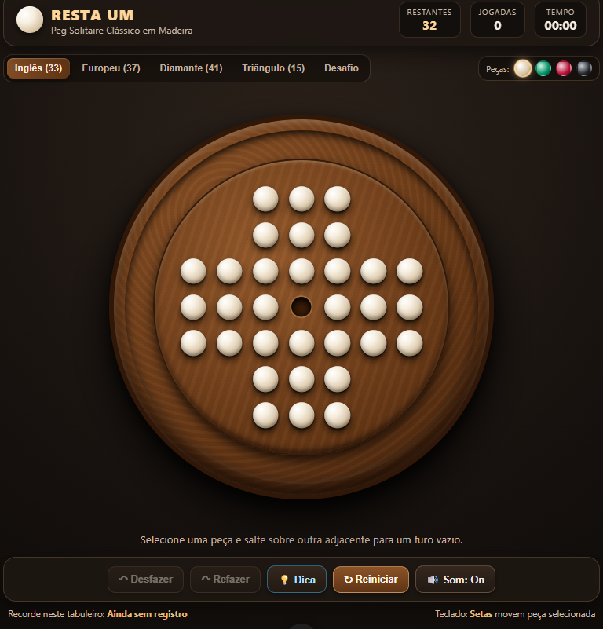

# 🪵 Resta Um (Peg Solitaire Clássico)

Versão digital tátil do clássico quebra-cabeça **Resta Um** (*Peg Solitaire*), ambientada em um tabuleiro circular de madeira nobre com calha periférica escavada para acomodar as peças capturadas e um motor de inteligência artificial integrado para sugestões de jogadas.

🔗 **Link para execução online:** [https://denis-tek.github.io/jogos/resta-um/](https://denis-tek.github.io/jogos/resta-um/)

---

## 📸 Preview

---

## ✨ Funcionalidades

* **5 Variantes de Tabuleiro:**
  * **Inglês (33 furos):** O formato tradicional em cruz simétrica.
  * **Europeu (37 furos):** Tabuleiro octogonal clássico com furos diagonais adicionais.
  * **Diamante (41 furos):** Configuração expandida em losango para partidas mais longas.
  * **Triângulo (15 furos):** Variante triangular clássica de 5 fileiras.
  * **Modo Desafio:** 4 estágios progressivos de finais táticos (de 6 a 12 peças) ideais para treino rápido.
* **4 Acabamentos de Peças:** Personalização instantânea das esferas entre **Marfim Clássico**, **Esmeralda**, **Rubi** e **Madeira Escura**.
* **Jogabilidade Fluida:** Movimentação por clique/toque, arrastar e soltar (*Drag & Drop*) ou setas direcionais do teclado, com encadeamento automático de saltos múltiplos e histórico ilimitado de **Desfazer (`Ctrl+Z`)** e **Refazer (`Ctrl+Y`)**.
* **Calha Periférica Dinâmica:** Cada peça eliminada é animada e acomodada automaticamente ao longo do sulco circular externo do tabuleiro.
* **Cronômetro e Recordes:** Registro automático do menor número de peças restantes e menor tempo por variante no `localStorage`.

---

## 🧠 Tecnologias e Algoritmos

* **Solucionador Inteligente (`Bitboard` + `DFS`):** O botão **💡 Dica** utiliza busca em profundidade (*Depth-First Search* com *backtracking* e memoização de estados visitados) representando o tabuleiro inteiro em um único inteiro de 64 bits via `BigInt`. Isso permite avaliar dezenas de milhares de ramificações em milissegundos para encontrar caminhos vencedores até restar apenas 1 peça.
* **Web Audio API (Foley Procedural):** Sintetizador acústico sem arquivos externos que reproduz o clique leve ao selecionar uma peça, a batida oca na madeira ao encaixá-la no furo e o som das peças rolando na calha periférica.
* **CSS3 Realism & Pointer Events:** Uso de gradientes multicamada para simular veios de madeira, cavidades rebaixadas e brilho especular nas esferas, aliado a eventos unificados de ponteiro (`pointerdown`, `pointermove`, `pointerup`).