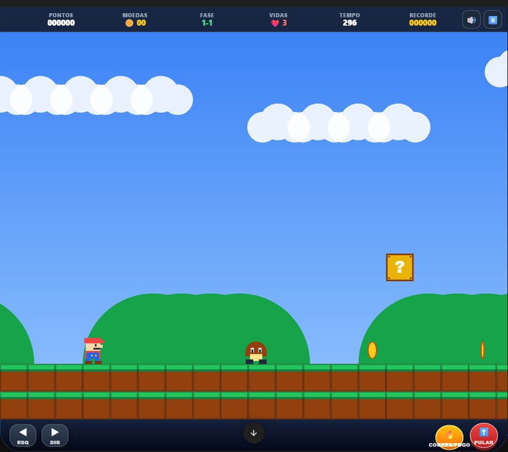

# 🍄 Super Mario Web — Aventura Clássica

[](https://denis-tek.github.io/jogos/super-mario/)
[](https://denis-tek.github.io/jogos/)

Um jogo de plataforma clássico com rolagem lateral (*side-scrolling*) inspirado no icônico **Super Mario Bros.**, desenvolvido em **HTML5, CSS3 e JavaScript puro** em um único arquivo autocontido (`index.html`), com física calibrada, sistema de Power-Ups e trilha/efeitos sintetizados em tempo real.

🔗 **Jogar online:** [https://denis-tek.github.io/jogos/super-mario/](https://denis-tek.github.io/jogos/super-mario/)

---

## 🖼️ Preview



---

## ✨ Principais Recursos

- **3 Fases Temáticas Progressivas:**
  - **1-1 Reino dos Cogumelos:** Cenário ensolarado clássico com colinas, nuvens, tubos verdes, blocos `?` e inimigos introdutórios.
  - **1-2 Subterrâneo Azul:** Caverna noturna com estalactites, abismos e plataformas móveis horizontais e verticais.
  - **1-3 Fortaleza do Crepúsculo:** Cenário final com pilares sombrios, poços de lava, plataformas móveis e obstáculos de precisão.
- **Sistema Completo de Power-Ups e Estados:**
  - **Mario Pequeno:** Ágil e compacto para atravessar passagens estreitas.
  - **Super Mario (Super Cogumelo):** Cresce de tamanho, ganha resistência extra a um impacto e passa a quebrar blocos de tijolo ao atingi-los por baixo.
  - **Mario de Fogo (Flor de Fogo):** Permite disparar até 2 bolas de fogo simultâneas que quicam pelo cenário e derrotam inimigos à distância.
- **Física de Plataforma Responsiva:**
  - **Pulo Variável:** A altura do salto responde ao tempo em que o botão permanece pressionado, com impulso adicional ao correr.
  - **Assistências de Precisão:** Inclui *Coyote Time* (`0.11s`), *Jump Buffer* (`0.12s`) e *Corner Correction* (`8px`) para evitar engates nas quinas dos blocos durante a subida.
- **Inimigos Interativos:**
  - **Goombas:** Achatam ao receberem um pisão por cima.
  - **Koopa Troopas:** Recolhem-se no casco ao serem pisados; você pode chutar o casco para deslizar e derrubar outros inimigos em sequência.
- **Áudio Retrô Sintetizado (`Web Audio API`):** Trilha sonora temática para cada fase e efeitos sonoros de pulo, moeda, brotar/coleta de power-up, bola de fogo, quebra de bloco, pisão, dano e vitória — sem arquivos `.mp3` ou `.wav` externos.
- **Layout Responsivo (`100dvh` sem rolagem) & Persistência:** HUD compacto no topo com pontuação, moedas (a cada 100 moedas ganha `1-UP`), fase, vidas, cronômetro e recorde salvo automaticamente no `localStorage`.

---

## 🎮 Controles & Como Jogar

### Computador (Teclado)
| Tecla | Ação |
| :--- | :--- |
| `←` / `→` ou `A` / `D` | Mover para a esquerda / direita |
| `Espaço`, `Z`, `W` ou `↑` | Pular (segure para salto mais alto) |
| `Shift`, `X` ou `J` | Correr e disparar **Bola de Fogo** (quando estiver como Mario de Fogo) |
| `P` ou `Esc` | Pausar / Retomar partida |

### Dispositivos Móveis e Touch
- **Botões Direcionais (`◀` / `▶`):** Movimentação horizontal responsiva na base da tela.
- **Botões de Ação (`🔥` / `⬆️`):** Suporte **Multi-Touch** simultâneo para correr/atirar e pular ao mesmo tempo no celular.

---

## 📁 Estrutura do Projeto

```text
super-mario/
├── index.html      # Aplicação completa autocontida (HTML5 + CSS3 + JS + Canvas + Web Audio)
├── thumb.svg       # Miniatura vetorial exibida no launcher principal
├── imagem.png      # Captura de tela do jogo em execução
└── README.md       # Documentação do projeto
```

---

## 🛠️ Tecnologias Utilizadas

- **HTML5 Canvas 2D:** Renderização dinâmica de cenários, tiles, partículas, projeções e personagens em alta nitidez (`devicePixelRatio`).
- **CSS3 Moderno:** Layout responsivo em tela cheia (`100dvh`), botões arcade táteis e modais sobrepostos.
- **JavaScript (ES6+):** Loop de jogo com delta de tempo limitado, detecção de colisão AABB em grade com *Corner Correction*, máquina de estados de entidades e persistência local (`localStorage`).
- **Web Audio API:** Sintetizador chiptune procedural para música de fundo por fase e efeitos sonoros em tempo real.

---

## 🚀 Como Executar Localmente

1. Clone este repositório:
   ```bash
   git clone https://github.com/Denis-Tek/jogos.git
   ```
2. Inicie um servidor HTTP simples na pasta raiz `jogos/` (ex.: `python -m http.server 8000`) e acesse `http://localhost:8000/super-mario/`, ou abra `super-mario/index.html` diretamente em qualquer navegador moderno.

---

Desenvolvido por **[Denis-Tek](https://github.com/Denis-Tek)**.