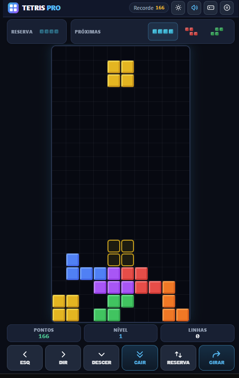

# 🧱 Tetris

[](https://denis-tek.github.io/jogos/tetris/)
[](#tecnologias-e-arquitetura)
[](#tecnologias-e-arquitetura)
[](#tecnologias-e-arquitetura)

Recriação moderna e responsiva do clássico quebra-cabeça de blocos empilháveis para navegador, desenvolvida em **arquivo único autônomo (`index.html`)** com física precisa de rotação, peça fantasma (*Ghost Piece*), reserva de peça (*Hold*), aceleração progressiva por nível e efeitos sonoros sintetizados em tempo real.

🔗 **Jogue agora:** [https://denis-tek.github.io/jogos/tetris/](https://denis-tek.github.io/jogos/tetris/)



---

## ✨ Funcionalidades

* **Matriz Oficial `10×20` e 7 Tetrominós Clássicos:** Peças `I`, `O`, `T`, `S`, `Z`, `J` e `L` com cores de alto contraste e sombreamento chanfrado.
* **Gerador Justo (*7-Bag Randomizer*):** Sorteio embaralhado em sacolas de 7 peças distintas, evitando longas secas ou repetições excessivas da mesma peça.
* **Sistema de Rotação com *Wall Kicks*:** Ajuste automático de posição ao rotacionar peças próximas às paredes laterais, ao piso ou a blocos já fixados.
* **Peça Fantasma (*Ghost Piece*) & Reserva (*Hold*):** Projeção visual do ponto exato de aterrissagem na base da matriz e compartimento para guardar/trocar uma peça estrategicamente.
* **Pré-visualização (*Next*) e Progressão de Velocidade:** Exibição das próximas peças da fila e aumento gradual da gravidade a cada 10 linhas eliminadas.
* **Áudio Procedural (Web Audio API):** Efeitos sonoros gerados via osciladores para movimentação, rotação, queda rápida (*Hard Drop*), limpeza de linhas (*Single*, *Double*, *Triple*, *Tetris*) e fim de partida.
* **Persistência Local:** Salvamento automático do recorde de pontuação (`localStorage`) integrado ao launcher principal.

---

## 🎮 Controles e Regras

### Teclado e Toque
| Ação | Teclado | Controles na Tela / Toque |
| :--- | :--- | :--- |
| **Mover para Esquerda / Direita** | `←` / `→` ou `A` / `D` | Botões direcionais ou arraste horizontal |
| **Queda Suave (*Soft Drop*)** | `↓` ou `S` | Botão para baixo ou arraste vertical |
| **Queda Instantânea (*Hard Drop*)** | `Espaço` | Botão de queda rápida / toque rápido para baixo |
| **Rotacionar (Horário / Anti-horário)** | `↑` / `X` e `Z` / `Ctrl` | Botão de rotação ou toque na matriz |
| **Reservar Peça (*Hold*)** | `C` ou `Shift` | Botão *Hold* |
| **Pausar / Retomar** | `P` ou `Esc` | Botão de pausa no cabeçalho |

### Sistema de Pontuação
* **Soft Drop:** $+1$ ponto por célula descida manualmente.
* **Hard Drop:** $+2$ pontos por célula percorrida na queda instantânea.
* **1 Linha (*Single*):** $100 \times \text{Nível}$
* **2 Linhas (*Double*):** $300 \times \text{Nível}$
* **3 Linhas (*Triple*):** $500 \times \text{Nível}$
* **4 Linhas (*Tetris*):** $800 \times \text{Nível}$

---

## 🛠️ Tecnologias e Arquitetura

Projetado sob o padrão **Single-File Self-Contained Architecture** do repositório:

* **HTML5 `<canvas>` / Grid de Alta Performance:** Renderização fluida a 60 FPS com suporte a telas HiDPI/Retina e layout responsivo *zero-scroll*.
* **JavaScript Modular (ES2020+):** Máquina de estados completa para loop de gravidade, tempo de travamento (*Lock Delay*), detecção de colisões e cálculo de combos.
* **Web Audio API:** Síntese sonora nativa sem dependências externas de áudio.

---

## 🚀 Como Executar Localmente

1. Clone o repositório principal:
   ```bash
   git clone https://github.com/Denis-Tek/jogos.git
   ```
2. Abra o arquivo `tetris/index.html` diretamente no seu navegador.

---

Desenvolvido por **[Denis-Tek](https://github.com/Denis-Tek)**.