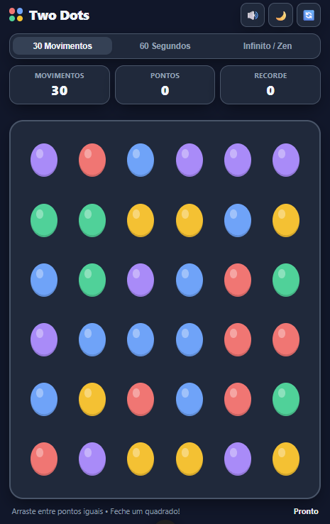

# 🔴🔵🟢🟡🟣 Two Dots — Puzzle de Conexões

Implementação web minimalista e responsiva inspirada no clássico puzzle **Dots / Two Dots**, desenvolvida em arquivo único (`index.html`) com grade interativa `6×6`, detecção de circuitos fechados (*loops*) e áudio sintetizado em escala pentatônica.

🔗 **Link para execução online:** [https://denis-tek.github.io/jogos/two-dots/](https://denis-tek.github.io/jogos/two-dots/)

---

## 📸 Preview

---

## ✨ Funcionalidades e Regras do Jogo

* **Regras de Conexão e Circuitos (Loops):**
  * **Conectar Pontos Iguais:** Clique ou toque e arraste entre dois ou mais pontos adjacentes da **mesma cor** na horizontal ou vertical (diagonais não são permitidas).
  * **Recuo de Traçado:** Arraste de volta para o ponto anterior da cadeia para desfazer o último passo antes de soltar.
  * **Fechar um Quadrado (*Loop*):** Conecte pontos formando um circuito fechado (como um quadrado `2×2` ou polígono fechado) para **eliminar todos os pontos daquela cor no tabuleiro inteiro** e dobrar a pontuação da jogada.
  * **Gravidade e Reposição:** Ao finalizar a cadeia, os pontos conectados desaparecem, os superiores caem por gravidade e novas peças preenchem o topo da grade `6×6`.
* **3 Modos de Jogo:**
  * **30 Movimentos:** Planeje cada conexão e busque formar quadrados para maximizar sua pontuação em 30 jogadas.
  * **60 Segundos:** Desafio contra o relógio com barra de progresso visual e alerta nos últimos 10 segundos.
  * **Infinito / Zen:** Partida livre sem limite de tempo ou movimentos para relaxar.
* **Embaralhamento Automático & Recordes:**
  * Verificação automática de jogadas válidas após cada queda, embaralhando a grade caso não restem pares adjacentes, com salvamento dos recordes por modo no `localStorage`.
* **Feedback Visual e Sonoro:**
  * Escala pentatônica ascendente conforme pontos são encadeados (com acorde especial ao fechar um quadrado), alternância entre **Tema Claro** e **Tema Escuro** e layout *zero-scroll* (`100dvh`).

---

## 🛠️ Tecnologias e Algoritmos

* **HTML5 & CSS Grid:** Grade interativa `6×6` com áreas de toque precisas, animações fluidas de queda e layout responsivo ajustado em `100dvh`.
* **SVG Dinâmico:** Renderização vetorial nítida das linhas de conexão e polígonos fechados sobrepostos aos pontos.
* **JavaScript (ES6+) — Grafos e Detecção de Ciclos:** Validação de adjacência ortogonal, detecção de fechamento de circuitos (*loops*), simulação de gravidade e verificação de movimentos disponíveis.
* **Web Audio API & `localStorage`:** Síntese sonora procedural em escala pentatônica via `AudioContext` (sem arquivos externos) e persistência local de recordes e preferências visuais.