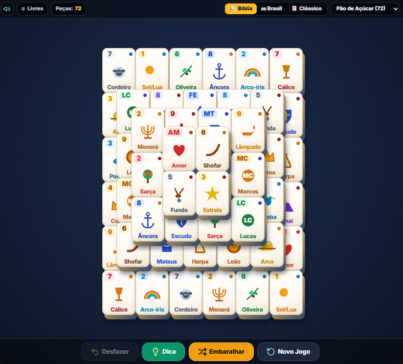

# 🀄 Mahjong Brasil — Edição Vita

[](https://denis-tek.github.io/jogos/vita-mahjong/)
[](#tecnologias-utilizadas)
[](#tecnologias-utilizadas)
[](#tecnologias-utilizadas)

Uma versão brasileira, acessível e de alta visibilidade do clássico **Mahjong Solitaire**, desenvolvida em **HTML5, CSS3 e JavaScript puro** em um único arquivo (`index.html`), sem dependências externas de imagens ou arquivos de áudio.

🔗 **Jogar online:** [https://denis-tek.github.io/jogos/vita-mahjong/](https://denis-tek.github.io/jogos/vita-mahjong/)



---

## ✨ Principais Recursos

### 🎨 3 Temas Completos com Troca Instantânea (34 tipos de peças em SVG)
Alterne entre os baralhos no meio da partida sem perder o progresso atual:
1. **🕊️ Bíblia (Padrão):** Símbolos da Criação, Objetos Sagrados, Marcos Históricos, os 4 Evangelistas (Mateus, Marcos, Lucas e João) e as 3 Virtudes (Fé, Esperança e Amor).
2. **🇧🇷 Brasil:** Fauna brasileira (Arara, Onça, Tucano, Capivara, Mico, Tartaruga, Boto, Tamanduá, Lobo), Flora e Frutas (Açaí, Caju, Guaraná, Abacaxi, Ipê, Vitória-régia, Araucária, Café, Cacau), Cultura (Pandeiro, Violão, Berimbau, Cristo, Pão de Açúcar, Chapéu, Chimarrão, Boi, Filtro), Biomas e Ritmos.
3. **🀄 Clássico:** Bambus, Círculos, Caracteres (Wan), Ventos e Dragões tradicionais.

### 🧩 5 Formatos de Tabuleiro Verticais (48 a 96 peças)
Layouts ergonômicos de até 6 colunas de largura para maximizar o tamanho das peças em telas de celular (`100dvh`, zero rolagem):
- **Desafio Rápido** (`48` peças — 3 camadas)
- **Pirâmide** (`60` peças — 5 camadas)
- **Pão de Açúcar** (`72` peças — 4 camadas)
- **Coroa** (`84` peças — 5 camadas)
- **Catedral** (`96` peças — 6 camadas)

### ⚙️ Mecânicas e Acessibilidade
- **Gerador 100% Solucionável com Dispersão Espacial:** Constrói cada tabuleiro de trás para frente em pares livres, penalizando peças idênticas adjacentes ou empilhadas diretamente na mesma coluna.
- **Iluminação Uniforme + Modo "Livres" Opcional:** Por padrão, todas as peças permanecem 100% iluminadas para um visual limpo e realista, com um botão **Livres** no topo para escurecer peças bloqueadas caso o jogador deseje auxílio visual.
- **Finalização Automática em Cascata (*Auto-Finish*):** Assim que todas as peças restantes estiverem simultaneamente desbloqueadas, o jogo conclui os pares automaticamente com brilho dourado, partículas e escala pentatônica ascendente.
- **Áudio Procedural (Web Audio API):** Efeitos sonoros sintetizados em tempo real (toque de madeira/marfim, feedback de bloqueio, combos, embaralhamento e fanfarra de vitória).
- **Assistentes Completos:** **Desfazer**, **Dica**, **Embaralhar** (com preservação de solubilidade) e salvamento automático de preferências via `localStorage`.

---

## 🎮 Regras Básicas

- Combine **pares de peças 100% idênticas** (mesmo símbolo, cor e nome).
- Uma peça só pode ser selecionada se estiver **livre**: sem nenhuma peça acima dela (`z + 1`) e com **pelo menos um dos lados** (esquerdo ou direito) desbloqueado.
- Combine pares em sequência rápida para multiplicar sua pontuação (**Combos**).

---

## 🚀 Como Executar

Por ser construído sob a arquitetura **Single-File HTML5**, não há etapa de compilação ou instalação de pacotes:

1. Clone este repositório:
   ```bash
   git clone https://github.com/Denis-Tek/jogos.git
   ```
2. Acesse a pasta `vita-mahjong/` e abra o arquivo `index.html` diretamente em qualquer navegador moderno (Chrome, Edge, Safari, Firefox).

---

## 📁 Estrutura do Projeto

```text
vita-mahjong/
├── index.html   # Aplicação completa autocontida (HTML5 + CSS3 + JS + SVG + Web Audio)
├── imagem.png   # Captura de tela do jogo em execução
└── README.md    # Documentação do projeto
```

---

## 🛠️ Tecnologias Utilizadas

- **HTML5 / CSS3** (Custom Properties, Flexbox, Animações Keyframes, `100dvh`)
- **Tailwind CSS** (via CDN para utilitários de layout responsivo)
- **JavaScript (ES6+)** (Algoritmo de geração reversa, renderização vetorial SVG inline e gerenciamento de estado)
- **Web Audio API** (Síntese sonora procedural sem assets externos)
