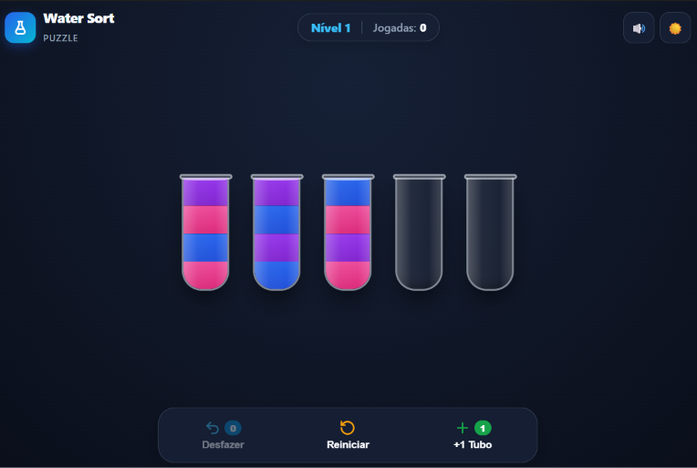

# 🧪 Water Sort Puzzle

Jogo casual de lógica e organização desenvolvido em arquivo único (`index.html`), onde o objetivo é separar líquidos coloridos misturados em tubos de ensaio até que cada frasco contenha apenas uma única cor e esteja completamente cheio.

🔗 **Link para execução online:** [https://denis-tek.github.io/jogos/water-sort/](https://denis-tek.github.io/jogos/water-sort/)

---

## 📸 Preview

---

## ✨ Funcionalidades e Regras do Jogo

* **Regras de Despejo e Conclusão:**
  * Selecione um tubo de origem e toque no tubo de destino para transferir as camadas superiores do líquido.
  * O despejo só é permitido quando o tubo de destino estiver vazio ou possuir a **mesma cor no topo** com espaço disponível.
  * Ao preencher um tubo com **4 camadas idênticas**, ele é automaticamente selado com uma rolha de cortiça.
* **Geração de Fases Garantidamente Solucionáveis:**
  * Progressão gradual que começa com **3 cores + 2 tubos vazios** e avança até **12 cores + 2 tubos vazios**.
  * Embaralhamento validado por um solucionador interno (**Solver DFS**) com *fallback* reverso, evitando fases sem solução.
* **Paleta Cromática de Alto Contraste:**
  * **Grupo Prioritário (9 cores):** Vermelho, Azul, Amarelo, Verde, Laranja, Roxo, Ciano, Rosa e Marrom para máxima distinção visual.
  * **Grupo de Expansão (5 cores):** Verde-Lima, Índigo, Coral, Azul-Petróleo e Dourado habilitados automaticamente a partir de 10 cores.
* **Ferramentas de Apoio & Temas:**
  * Histórico de **Desfazer**, botão **Reiniciar**, recurso de **+1 Tubo** extra por fase e alternância instantânea entre **Tema Escuro** e **Tema Claro** com salvamento automático no `localStorage`.

---

## 🛠️ Tecnologias e Algoritmos

* **Solver DFS (*Depth-First Search*):** Busca em profundidade com poda de estados equivalentes utilizada na validação matemática das fases geradas.
* **CSS3 Fluido & Web Animations API:** Layout responsivo *zero-scroll* (`100dvh` e `clamp()`) que organiza os frascos em 1 ou 2 fileiras equilibradas, aliado a animações suaves de inclinação e transferência de líquido.
* **Web Audio API (Síntese Procedural):** Efeitos sonoros gerados em tempo real via código (seleção, fluxo de despejo, alerta de movimento inválido, acorde de tubo selado e fanfarra de vitória).
* **Web Storage API (`localStorage`):** Persistência automática do nível alcançado e das preferências de tema e áudio do jogador.