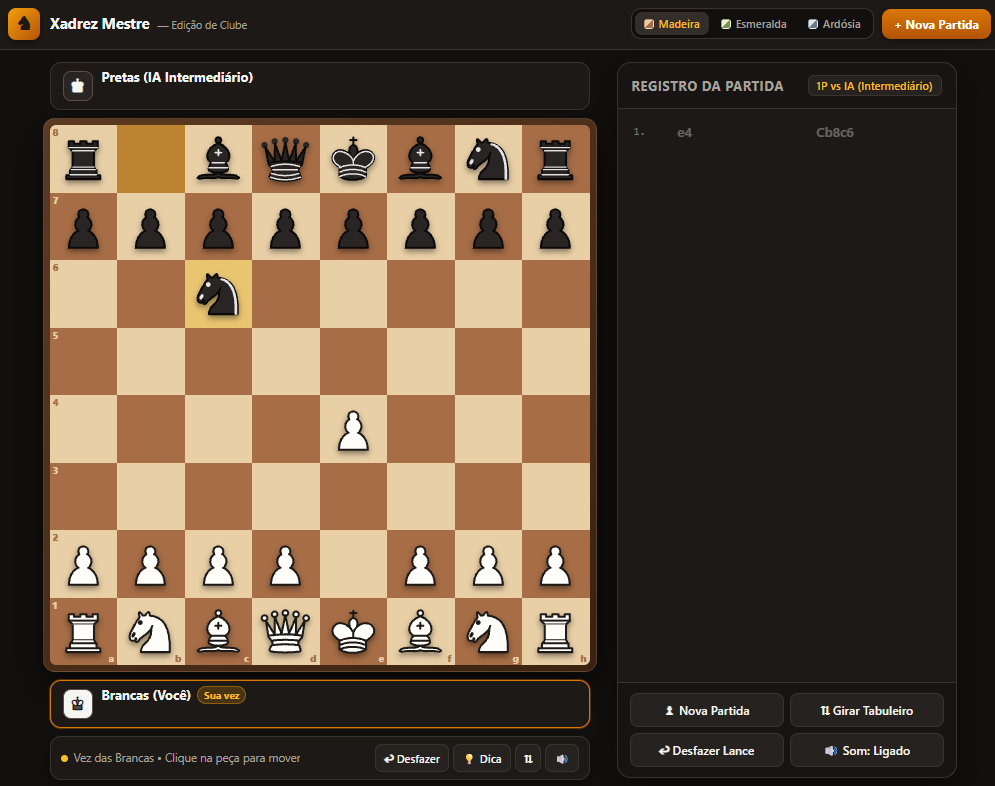

# ♞ Xadrez Mestre — Edição de Clube

[](https://denis-tek.github.io/jogos/xadrez/)
[](https://denis-tek.github.io/jogos/)

Aplicação web completa, sofisticada e totalmente autônoma de **Xadrez**, desenvolvida em **arquivo único (`index.html`)** sem dependências externas. Combina estética clássica de clube com peças Staunton vetoriais, motor completo de regras oficiais, inteligência artificial com Poda Alfa-Beta, áudio sintetizado em tempo real e modo de revisão tática pós-partida.

🔗 **Link para execução online:** <https://denis-tek.github.io/jogos/xadrez/>

---

## 📸 Preview



---

## ✨ Funcionalidades e Regras do Jogo

* **Motor Completo de Regras Oficiais:**
  * Validação rigorosa de todos os lances legais (impedindo movimentos que deixem o próprio Rei em xeque).
  * **Lances Especiais:** Roque pequeno (`O-O`), Roque grande (`O-O-O`), captura *En Passant* e modal interativo para **Promoção de Peão** (Dama, Torre, Bispo ou Cavalo).
  * **Condições de Encerramento Automático:** Xeque-mate, Empate por Afogamento, Insuficiência de Material, Regra dos 50 Lances e Repetição Tripla de Posição.
  * **Notação Algébrica em Português:** Histórico completo utilizando iniciais padrão (`R`, `D`, `T`, `B`, `C`), desambiguação e indicadores de xeque (`+`) e mate (`#`).

* **Inteligência Artificial & Modos de Jogo:**
  * **1 Jogador vs IA (3 Níveis):** Dificuldades **Iniciante**, **Intermediário** e **Avançado** impulsionadas pelo algoritmo **Minimax com Poda Alfa-Beta**, ordenação de capturas e tabelas posicionais (*Piece-Square Tables*).
  * **2 Jogadores (Local):** Modo passe-e-jogue no mesmo dispositivo.
  * **Escolha de Cor & Relógio Digital:** Opção de jogar de Brancas, Pretas ou Aleatório, com controle de tempo configurável (**Livre**, **3 min**, **5 min** ou **10 min**).

* **Revisão Tática Pós-Partida & Exportação PGN:**
  * Barra integrada de navegação (`|◀`, `◀`, `▶ Auto / ⏸ Pausar`, `▶`, `▶|`) logo abaixo do tabuleiro ao encerrar a partida.
  * Classificação automática de lances com selos táticos (`★ Melhor`, `✓ Bom Lance`, `?! Imprecisão`, `? Erro`, `?? Capivarada`), barra vertical de avaliação em vantagem de peões e exportação completa no formato **PGN** (*Portable Game Notation*).

* **Estética de Clube & Assistentes:**
  * Peças Staunton vetoriais em SVG inline, 3 temas visuais (**Madeira Nobre**, **Esmeralda Torneio** e **Ardósia Moderna**), botão de **Dica**, **Desfazer Lance**, **Girar Tabuleiro** e efeitos sonoros sintetizados.

### Atalhos de Teclado (Modo Revisão)

| Tecla | Ação |
| :--- | :--- |
| `←` / `→` | Volta ou avança um lance na revisão |
| `Espaço` | Inicia ou pausa a reprodução automática (*Auto-play*) |
| `Home` / `End` | Vai para a posição inicial ou final da partida |

---

## 🛠️ Tecnologias e Algoritmos

* **HTML5 Semântico & Acessível:** Estruturação com atributos ARIA (`role="grid"`, `aria-label`) e modais nativos.
* **CSS3 Moderno (Grid, Flexbox & Custom Properties):** Layout rígido e imóvel com proporção quadrada travada e troca dinâmica entre os 3 temas de tabuleiro.
* **JavaScript (ES6+) — Minimax Alfa-Beta & Piece-Square Tables:** Motor de regras orientado a objetos, gerenciamento de *snapshots* de posição, avaliação heurística e análise tática pós-jogo.
* **SVG Inline & Web Audio API:** Peças Staunton vetoriais nítidas em qualquer resolução e síntese sonora procedural em tempo real sem arquivos externos.

---

## 🚀 Como Executar Localmente

1. Clone o repositório principal:
   ```bash
   git clone https://github.com/Denis-Tek/jogos.git
   ```
2. Abra o arquivo `xadrez/index.html` diretamente em qualquer navegador moderno.

---

Desenvolvido por [**Denis-Tek**](https://github.com/Denis-Tek).